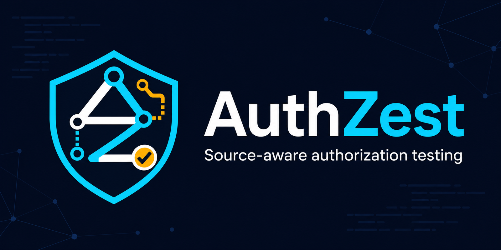

<p align="center">
  
</p>

<p align="center">
  <strong>English</strong> ·
  <a href="docs/i18n/ko/README.md">한국어</a> ·
  <a href="docs/i18n/ja/README.md">日本語</a> ·
  <a href="docs/i18n/ru/README.md">Русский</a>
</p>

# AuthZest

AuthZest is an open-source FastAPI authorization-testing project with a Python CLI and a local web
dashboard. For one self-contained FastAPI file in another folder, `repo-fix` asks Codex for an HTTP
proof-of-concept and a repair of a GET object-ownership defect. It checks the exact before and after
source in isolated containers against cases you reviewed, and only then offers to write the original
file, keeping a backup for recovery. Static declaration scanning and the packaged owner-read scenario
remain available.

**This README describes the 0.1.0 source scope.** The package version is `0.1.0`; package metadata
alone does not establish publication. Check [GitHub Releases](https://github.com/casing1/authzest/releases)
for available tags, files and checksums. The earlier
[v0.1.0-alpha.4](https://github.com/casing1/authzest/releases/tag/v0.1.0-alpha.4), published 2026-11-05 KST,
predates the current GUI and newly generated owner-read repair workflow.
[0.1.0 notes](docs/releases/0.1.0.md) · [Final readiness](docs/releases/0.1.0-READINESS.md) · [Changelog](CHANGELOG.md)

**Status — 2026-11-25 KST.** The external flow ran end to end on the bundled demo with a real Codex
model and Docker Desktop. The model's PoC reproduced the reviewed defect (5/5 before cases), its
repair matched all 5 after cases, and the original file was written with a backup. A later user edit
made `repo-restore` refuse, and once the edit was removed it restored the original bytes. The same
flow then passed again from a fresh wheel installation: a new PoC and repair, 5/5 before and after,
the write and an installed `repo-restore`. Stable publication still waits for the remaining release
checks. [External fix guide](docs/guides/REPOSITORY_HTTP_FIX.md)

## What you can do

| Feature                | Current source behavior                                                                                                                                                                                                                                       |
| ---------------------- | ------------------------------------------------------------------------------------------------------------------------------------------------------------------------------------------------------------------------------------------------------------- |
| External file repair   | `repo-fix`: share one selected file and policy, get a GET PoC and repair, run isolated before/after checks against your reviewed cases, then approve the original write with backup, conflict refusal and `repo-restore` recovery.                            |
| Static source scan     | Discover supported FastAPI/router declarations, prefixes and dependencies without importing or executing the target app. Read source locations, diagnostics and partial-analysis status.                                                                      |
| AI proposal            | Preview the exact packaged source and policy, then request a newly authored defensive test and one-file availability-rule repair through the existing Codex adapter. No-change and unknown are valid outcomes.                                                |
| Reviewed copy workflow | Review separate runtime, sharing, copy, before, diff, apply, after and restore decisions. Test the generated regression and seven maintained controls in reviewed network-disabled Linux guests. Apply only to a fresh private copy.                          |
| Local GUI              | Run the same owner-read engine with current typed decisions, inspect generated code/diffs, before/after and recovery, and download the complete JSON. Ordinary launch supports static inventory and saved-result viewing, including saved `repo-fix` results. |

The GUI's active AI workflow targets **one maintained synthetic scenario**; `repo-fix` targets the
narrow external scope below. A repository selected for static scanning is not automatically sent to
Codex or repaired. General repository repair and arbitrary application execution are outside the
supported scope. [Workflow contract](docs/development/GENERATED_REPAIR_CONTRACT.md)

## Repair an external FastAPI file

Prepare the reviewed runtime once from the source checkout (macOS arm64, Python 3.12, Docker Desktop).
This downloads 14 pinned wheels from PyPI and verifies every byte. It then builds the two images without
running any target code, and writes a private profile under `~/.authzest/runtime`:

```bash
mkdir -p -m 700 ~/.authzest ~/.authzest/runtime
.venv/bin/python -m scripts.repository_http_runtime_setup wheels --output ~/.authzest/runtime/wheels
.venv/bin/python -m scripts.repository_http_runtime_setup build --wheelhouse ~/.authzest/runtime/wheels
.venv/bin/python -m scripts.repository_http_runtime_setup profile
```

Copy the demo outside the repository, review its five cases, then run the flow:

```bash
cp -R examples/external_notes_app ~/authzest-demo-notes
.venv/bin/authzest repo-fix ~/authzest-demo-notes --source app.py --policy policy.txt --model EXPLICIT_MODEL --cases examples/external_notes_app/cases.json --runtime-profile ~/.authzest/runtime/runtime.json
```

Use Codex CLI `0.153.0` signed in with ChatGPT and a model ID that your login lists. Each effect asks for its own code, which expires after
300 seconds: share, copy, run-before, apply-private, run-after and apply-original. Type the whole
quoted phrase; Enter declines. `original-applied` means both checks matched your reviewed cases and the
file was written. `before-not-reproduced`, `after-not-verified`, `poc-not-covered` and
`original-conflict` stop safely without touching the original. Add `--json` to save the complete result
for the dashboard viewer. Undo the write while the file still holds exactly the applied repair:

```bash
.venv/bin/authzest repo-restore ~/.authzest/recovery/original-YYYYMMDDTHHMMSSZ-xxxxxxxx
```

For your own project, run `repo-fix` with `--preview-only` first. Copy the printed `case_basis` into a
case file with 4–8 reviewed GET cases. [External fix guide](docs/guides/REPOSITORY_HTTP_FIX.md)

### Supported scope and limits

- One flat `.py` application file (≤16 KiB) with a module-level `app`, plus a policy file (≤8 KiB).
- Only packages in the pinned image (FastAPI, Starlette, Pydantic, Uvicorn and their dependencies);
  in-memory data, no database, external service, environment configuration or startup lifespan.
- GET object ownership only, with relative paths without query strings and synthetic `x-user`,
  `x-user-id` or `x-role` headers. `Authorization`/JWT, cookies and real logins are not exercised.
- JSON or empty responses up to 4 KiB. You write the expected answers. The model's PoC must equal the
  designated regression request.
- Matching cases are finite observations, not general authorization assurance. Multi-file projects,
  routers in other modules, database-backed dependencies and other HTTP methods are unsupported.

### Original goal and roadmap

AuthZest set out to analyze general FastAPI projects for vulnerabilities and patch them automatically.
0.1.0 deliberately ships the narrow slice above, verified end to end, instead of an unverified general
claim. The next steps are:

1. A route → dependency → handler → data-access graph across files, building on the existing scan.
2. Multi-file proposals that choose their context from that graph.
3. Automatic runtime setup for real projects: dependencies, databases and data seeding.
4. Authentication adapters, such as JWT test identities, and other HTTP methods.

## Quick start: local dashboard

Use the editable source checkout for the current dashboard. The following commands are for macOS
or Linux with Python 3.12 and Node.js 22.13+ in the 22.x line, or Node.js 24, and npm.

```bash
git clone https://github.com/casing1/authzest.git
cd authzest
python3.12 -m venv .venv
.venv/bin/python -m pip install -e '.[ui]'
npm --prefix frontend ci
npm --prefix frontend run build
.venv/bin/authzest scan examples/fastapi_inventory
.venv/bin/authzest ui --workspace examples/fastapi_inventory
```

Open [the local dashboard](http://127.0.0.1:8000). This launch is read-only: inspect the example's
four Python files and three GET registrations, or select a saved workflow JSON. It requires no
website deployment. Run commands from the cloned directory; `.venv` and `frontend` live there.
Ctrl-C stops the server. Rebuild the frontend after changing its source.

## Run AI-assisted repair in the GUI

This mode requires a POSIX, non-frozen source installation, an existing Codex ChatGPT login, and
a reviewed owner-read Docker runtime configuration and image. The current adapter requires a
trusted Codex CLI version `0.153.0`. Follow the
[runtime preparation](docs/development/GENERATED_REPAIR_CONTRACT.md#running-the-approved-copy-workflow)
before starting. The configuration path below is a placeholder for your private absolute path.

```bash
.venv/bin/authzest ui --workspace examples/fastapi_inventory --ai-runtime-config /ABSOLUTE/PRIVATE/runtime.json
```

1. Open the **complete private AI workspace URL** printed by the terminal in a **new browser tab**.
   Keep its `authzest-ai` fragment in that initial URL. The page removes it and holds the capability
   only in memory. After a refresh, reopen the complete launch URL; a server restart creates a new one.
2. In AI repair, optionally check the existing login and enter the exact accessible model identifier.
   Preparing a run displays its runtime plan; it does not approve sharing.
3. Review each complete current plan and enter that step's exact phrase: **runtime → share → copy
   → before → diff → apply → after → restore**. Each decision is separate, single-use and expires.
4. Inspect the generated regression, source change, exact diff, observations and restoration state.
   Host activity shows workflow stages, not a live Codex token stream or raw account logs.
5. Download the result JSON to a familiar private folder before starting another run or closing
   the server. Its location follows your browser's download settings/list. Keep reported recovery
   files when needed. Completed/failed runs stop repeated session
   reads; a new active run resumes updates.

The maintained case's expected comparison is:

| Phase  | Owner reads archived note | Generated regression | Intended policy matches |
| ------ | ------------------------- | -------------------- | ----------------------- |
| Before | HTTP 403, a false denial  | Assertion fails      | 6/7                     |
| After  | HTTP 200                  | Passes               | 7/7                     |

These describe the fixture's intended demonstration, not a guarantee for a new model response.
The separate expected-profile count can be 7/7 in both phases. Check restoration and cleanup too:
an earlier passing test does not clear a recovery-required state. Cancelling after application can
leave a modified private copy; it does not automatically restore it. Original checkout bytes are
outside this workflow's write scope.

Active mode uses numeric loopback `127.0.0.1`, one process and no reload. Ordinary dashboard access,
saved JSON and the Vite development proxy do not grant active authority. The workspace selects only
the static scan root. [GUI guide](docs/guides/RESULT_VIEWER.md) · [Course walkthrough](docs/guides/COURSE_DEMO.md)

## CLI alternative

For the CLI alone, install Python 3.12 and pipx, then run from a source checkout:

```bash
pipx install --python 3.12 .
authzest --help
authzest scan /path/to/fastapi-project
authzest scan /path/to/fastapi-project --json
authzest scan /path/to/fastapi-project --json --strict
```

Replace the example path. If needed, run `pipx ensurepath` and reopen the terminal. Static scans
work without Codex. A returned partial report normally exits 0; `--strict` makes known partial
analysis exit 1, and invalid input exits 2. These are execution statuses, not security verdicts.

Using the quick start's editable `.venv`, the owner-read CLI can preview the full request without
sharing or execution:

```bash
.venv/bin/authzest owner-read-suggest --model EXPLICIT_MODEL --file-workflow --runtime-config /ABSOLUTE/PRIVATE/runtime.json --preview-only
```

Replace `EXPLICIT_MODEL` and the runtime path with reviewed values. For interactive CLI execution,
private JSON capture and existing registered-template tools, use the
[course guide](docs/guides/COURSE_DEMO.md) and [command guides](docs/README.md).

## Installation scope

| Route                                            | Supported use                                                                                                                                    |
| ------------------------------------------------ | ------------------------------------------------------------------------------------------------------------------------------------------------ |
| Editable source plus UI extra and frontend build | Current dashboard; active owner-read GUI/CLI on supported POSIX systems with the reviewed runtime.                                               |
| Regular wheel or source-installed pipx CLI       | CLI commands. Built dashboard assets are not bundled; use the editable checkout route for the GUI.                                               |
| Tag-specific standalone executables              | Experimental static scan/offline previews. Check the selected tag's notes for dashboard availability; active owner-read GUI/CLI requires source. |

See [GitHub Releases](https://github.com/casing1/authzest/releases) for published files and checksums.
The executables are unsigned and not notarized. Current-source native builds and their recorded
platform checks are documented in the [release guide](docs/releases/RELEASING.md); historical checks
do not certify a later candidate. PyPI and npm publication are not part of this release process.

## CLI diagnostics

```bash
authzest --version
authzest doctor
authzest doctor --json
```

The diagnostic checks Python and, when Codex is on PATH, its version and login status. It does not
start a model request. A login alone grants no source-sharing or file-stage decision. Missing Codex
does not block static scans.

## Development setup

From the repository root, create a development environment:

```bash
python3.12 -m venv .venv
source .venv/bin/activate
python -m pip install -e '.[dev]'
```

Windows PowerShell uses `py -3.12 -m venv .venv` and `.venv\Scripts\Activate.ps1` for portable CLI
development. Active owner-read execution and the operator GUI remain POSIX source-only.

## Verification

With the development environment active:

```bash
python -m pytest
ruff check .
ruff format --check .
npm --prefix frontend ci
npm --prefix frontend test
npm --prefix frontend run lint
npm --prefix frontend run format:check
npm --prefix frontend run build
node --test scripts/check_docs.test.mjs
node scripts/check_docs.mjs
node scripts/format.mjs markdown --check
```

Documentation checks validate links, paired commands and shell syntax without running examples.
Use the [guarded formatting commands](docs/development/FORMATTING.md). Developer-tool advisories
and candidate-specific decisions remain tracked in [#89](https://github.com/casing1/authzest/issues/89)
and [#171](https://github.com/casing1/authzest/issues/171); direct editor/API formatting is outside the wrapper.

## Architecture and further reading

The Python core, parser/analyzer, Codex adapter, runner and presentation layers remain separate.
The Typer CLI and FastAPI/React UI share the core workflow; changing the UI does not grant new
execution or source-sharing authority.

- [Documentation index](docs/README.md): command contracts, setup and reference APIs.
- [Development plan](docs/development/DEVELOPMENT_PLAN.md): current scope and historical delivery.
- [Course walkthrough](docs/guides/COURSE_DEMO.md): GUI, CLI and saved-result presentation.
- [Contributing](CONTRIBUTING.md): meaningful commits, tests, labels and branch rules.
- [Security policy](SECURITY.md): reporting and supported review boundaries.
- [MIT license](LICENSE) and [references and third-party software](docs/reference/THIRD_PARTY.md):
  no copied code; dependencies and bundled runtime components keep their own licenses.

Static declarations, supplied policy and finite test outcomes are different evidence. Diagnostics
and unknown/not-run/declined/failed states remain visible. AuthZest does not establish general
authorization assurance, production isolation or measured model superiority. Independent comparison
remains under [#84](https://github.com/casing1/authzest/issues/84); stable course delivery is tracked in
[#150](https://github.com/casing1/authzest/issues/150).
