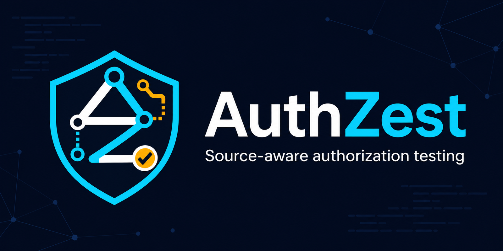

<p align="center">
  
</p>

<p align="center">
  <a href="../../../README.md">English</a> ·
  <a href="../ko/README.md">한국어</a> ·
  <strong>日本語</strong> ·
  <a href="../ru/README.md">Русский</a>
</p>

# AuthZest

AuthZest は、Python CLI とローカル Web ダッシュボードを備えた、FastAPI の認可テスト用
オープンソースプロジェクトです。別フォルダーにある自己完結した FastAPI ファイル一つについて、
`repo-fix` が Codex に GET オブジェクト所有権の欠陥を示す HTTP PoC と修正を依頼します。正確な修正前・
修正後のソースを隔離コンテナーで実行し、レビュー済みのケースと照合します。両方の検査に通った場合に
限り、バックアップを残して元のファイルへの書き込みを提案します。静的な宣言スキャンと同梱の所有者
読み取りシナリオも引き続き利用できます。

**この README は 0.1.0 ソースの対応範囲を説明しています。** パッケージのバージョンは `0.1.0` です。
パッケージ情報だけでは公開済みかどうかを判断できません。利用可能なタグ・ファイル・チェックサムは
[GitHub Releases](https://github.com/casing1/authzest/releases)を確認してください。2026-11-05 KST に公開された
[v0.1.0-alpha.4](https://github.com/casing1/authzest/releases/tag/v0.1.0-alpha.4) は、現在の GUI と、
新しく生成したコードによる所有者読み取り修正フローが追加される前の版です。
[0.1.0 の案内](../../releases/0.1.0.md) · [最終準備状況](../../releases/0.1.0-READINESS.md) · [変更履歴](../../../CHANGELOG.md)

**現在の状況 — 2026-11-25 KST。** 同梱のデモアプリで、実際の Codex モデルと Docker Desktop を使って
外部フロー全体を実行しました。モデルの PoC はレビュー済みの欠陥を再現し（修正前ケース 5/5）、修正は
修正後ケース 5 件すべてと一致し、バックアップを残して元のファイルに書き込まれました。その後ユーザーの
編集が加わると `repo-restore` は復元を拒否し、編集を戻した後には元のバイトを復元しました。続いて新しく
インストールした wheel からも同じフローが再び通りました。新しい PoC と修正を受け取り、修正前・修正後とも
5/5 一致した後に元のファイルへ書き込み、インストール版の `repo-restore` で復元しました。正式公開は
残りのリリース確認まで保留します。[外部修正ガイド（英語）](../../guides/REPOSITORY_HTTP_FIX.md)

## できること

| 機能                           | 現在のソースの動作                                                                                                                                                                                                                                   |
| ------------------------------ | ---------------------------------------------------------------------------------------------------------------------------------------------------------------------------------------------------------------------------------------------------- |
| 外部ファイルの修正             | `repo-fix`：選択したファイルとポリシーを共有して GET PoC と修正を受け取り、レビュー済みケースで隔離した修正前・修正後の検査を実行し、バックアップ・競合拒否・`repo-restore` による復元を備えた元ファイルへの書き込みを承認します。                   |
| ソースの静的スキャン           | 対象アプリを import・実行せず、対応する FastAPI/router の宣言・プレフィックス・依存関係を検出します。ソース位置、診断、部分解析の状態を確認できます。                                                                                                |
| AI の提案                      | 同梱の正確なソースとポリシーをプレビューしてから、既存の Codex アダプターを通じて、新しい防御的テストと、アプリファイル一つの利用可否ルールの修正を依頼します。変更なし・不明も有効な結果です。                                                      |
| 段階ごとに確認するコピーフロー | runtime・共有・コピー・before・diff・適用・after・復元をそれぞれ確認します。生成した回帰テストと管理対象の対照検査 7 件を、レビュー済みのネットワーク無効 Linux guest で実行します。適用先は新しい非公開コピーのみです。                             |
| ローカル GUI                   | 同じ所有者読み取りエンジンを使い、現在の確認文を入力して各段階を進めます。生成コード・diff・before/after・復旧状態を確認し、完全な JSON をダウンロードできます。通常起動では静的ルート一覧と、保存した `repo-fix` の結果を含む保存結果を表示します。 |

GUI のアクティブな AI フローの対象は **管理対象の合成シナリオ一つ**で、`repo-fix` は以下の狭い外部範囲を
扱います。静的スキャン用に選択したリポジトリが、自動的に Codex に送信されたり修正されたりすることは
ありません。一般リポジトリの修正や任意のアプリケーションの実行は対応範囲外です。[フローの契約](../../development/GENERATED_REPAIR_CONTRACT.md)

## 外部 FastAPI ファイルの修正

ソースのチェックアウトから、レビュー済みの runtime を一度だけ準備します（macOS arm64、Python 3.12、
Docker Desktop）。固定された wheel 14 個を PyPI から取得してすべてのバイトを検証し、対象コードを実行せずに
二つのイメージをビルドして、`~/.authzest/runtime` に非公開プロファイルを書き込みます。

```bash
.venv/bin/python -m scripts.repository_http_runtime_setup wheels --output ~/.authzest/runtime/wheels
.venv/bin/python -m scripts.repository_http_runtime_setup build --wheelhouse ~/.authzest/runtime/wheels
.venv/bin/python -m scripts.repository_http_runtime_setup profile
```

デモをリポジトリの外にコピーし、5 件のケースを確認してからフローを実行します。

```bash
cp -R examples/external_notes_app ~/authzest-demo-notes
.venv/bin/authzest repo-fix ~/authzest-demo-notes --source app.py --policy policy.txt --model EXPLICIT_MODEL --cases examples/external_notes_app/cases.json --runtime-profile ~/.authzest/runtime/runtime.json
```

Codex のログインで表示されるモデル ID を使ってください。効果ごとに 300 秒で失効する確認コードを個別に
求めます。順序は share、copy、run-before、apply-private、run-after、apply-original です。引用符内の
文全体を入力し、Enter は拒否になります。`original-applied` は両方の検査がレビュー済みケースと一致し、
ファイルに書き込まれたことを意味します。`before-not-reproduced`、`after-not-verified`、`poc-not-covered`、
`original-conflict` は元のファイルに触れずに安全に停止します。`--json` を付けると、ダッシュボードの
ビューアーで開ける完全な結果を保存できます。ファイルが適用した修正と完全に一致する間は、書き込みを
元に戻せます。

```bash
.venv/bin/authzest repo-restore ~/.authzest/recovery/original-YYYYMMDDTHHMMSSZ-xxxxxxxx
```

自分のプロジェクトでは、まず `--preview-only` 付きで `repo-fix` を実行します。表示された `case_basis` を、
レビュー済みの GET ケース 4〜8 件を含むケースファイルに写します。[外部修正ガイド（英語）](../../guides/REPOSITORY_HTTP_FIX.md)

### 対応範囲と制限

- モジュールレベルの `app` を持つフラットな `.py` アプリファイル一つ（16 KiB 以下）とポリシーファイル
  （8 KiB 以下）。
- 固定イメージ内のパッケージ（FastAPI、Starlette、Pydantic、Uvicorn とその依存関係）のみ。メモリ内データ
  だけを使い、データベース、外部サービス、環境設定、起動時の lifespan には対応しません。
- GET のオブジェクト所有権のみ。パスはクエリ文字列のない相対パスで、ID は合成の `x-user`、`x-user-id`、
  `x-role` ヘッダーです。`Authorization`/JWT、Cookie、実際のログインは検査しません。
- 応答は 4 KiB 以下の JSON または空の本文です。期待される応答はユーザーが書きます。モデルの PoC は指定した
  回帰リクエストと一致する必要があります。
- 一致したケースは有限の観測であり、一般的な認可の保証ではありません。複数ファイルのプロジェクト、
  別モジュールの router、データベースに依存する依存関係、その他の HTTP メソッドには対応しません。

### 当初の目標とロードマップ

AuthZest の当初の目標は、一般的な FastAPI プロジェクトの脆弱性を分析し、自動でパッチを当てることです。
0.1.0 は、検証されていない汎用的な主張ではなく、上記の狭い範囲を最初から最後まで検証した形で提供します。
次の段階は以下のとおりです。

1. 既存のスキャンを基に、ファイルをまたぐルート → 依存関係 → ハンドラー → データアクセスのグラフ。
2. そのグラフで文脈を選ぶ複数ファイルの提案。
3. 実プロジェクト向けの runtime 自動構成：依存関係、データベース、データ準備。
4. JWT のテスト ID などの認証アダプターと、その他の HTTP メソッド。

## クイックスタート：ローカルダッシュボード

現在のダッシュボードには editable ソース checkout を使います。以下は macOS または Linux 向けで、
Python 3.12 と、Node.js 22.x 系の 22.13 以降または Node.js 24、および npm が必要です。

```bash
git clone https://github.com/casing1/authzest.git
cd authzest
python3.12 -m venv .venv
.venv/bin/python -m pip install -e '.[ui]'
npm --prefix frontend ci
npm --prefix frontend run build
.venv/bin/authzest scan examples/fastapi_inventory
.venv/bin/authzest ui --workspace examples/fastapi_inventory
```

[ローカルダッシュボード](http://127.0.0.1:8000)を開きます。この起動は読み取り専用です。
例の Python ファイル 4 個と GET 登録 3 件を調べるか、保存したフローの JSON を選択します。
Web サイトのデプロイは不要です。コマンドは clone したディレクトリから実行してください。
`.venv` と `frontend` はその中にあります。Ctrl-C でサーバーを停止します。
フロントエンドのソースを変更した後は再ビルドしてください。

## GUI で AI による修正を実行する

このモードには、POSIX の non-frozen ソースインストール、既存の Codex ChatGPT ログイン、
信頼できる Codex CLI `0.153.0`、レビュー済みの owner-read Docker ランタイム設定とイメージが必要です。
アダプターは CLI のバージョンを固定して確認します。起動前に
[ランタイムの準備](../../development/GENERATED_REPAIR_CONTRACT.md#running-the-approved-copy-workflow)を
行ってください。以下の設定パスは、非公開の絶対パスに置き換えるための例です。

```bash
.venv/bin/authzest ui --workspace examples/fastapi_inventory --ai-runtime-config /ABSOLUTE/PRIVATE/runtime.json
```

1. ターミナルに表示された **非公開 AI ワークスペース URL 全体**を **新しいブラウザータブ**で開きます。
   最初の URL に `authzest-ai` フラグメントを含めてください。ページはこれを URL から除去し、
   接続権限をメモリ内だけに保持します。ページを再読み込みした場合は完全な起動 URL を開き直します。
   サーバーを再起動すると新しい URL が発行されます。
2. AI 修正画面で、必要に応じて既存のログインを確認し、アクセス可能なモデルの正確な識別子を入力します。
   実行の準備を開始すると runtime 計画が表示されます。この操作だけでは共有を承認しません。
3. 現在の完全な計画を確認し、その段階の正確な確認文を入力します。順序は **runtime → share → copy
   → before → diff → apply → after → restore** です。各決定は別々で、一度だけ使え、有効期限があります。
4. 生成した回帰テスト、ソース変更、正確な diff、観測結果、復元状態を確認します。
   ホストの活動欄はフローの段階を示すもので、Codex のトークン配信やアカウントの生ログではありません。
5. 次の実行を開始したりサーバーを終了したりする前に、ブラウザーのダウンロード設定で結果 JSON の
   保存先を確認します。使い慣れた非公開フォルダーを選ぶか、ダウンロード一覧で保存場所を探してください。
   必要な復旧ファイルも保持します。完了・失敗した実行のセッション反復取得は停止し、
   新しい実行が始まると更新を再開します。

管理対象のケースでは、次の比較を想定しています。

| 段階   | 所有者によるアーカイブ済みノートの読み取り | 生成した回帰テスト | 意図したポリシーとの一致 |
| ------ | ------------------------------------------ | ------------------ | ------------------------ |
| Before | HTTP 403、誤った拒否                       | assertion が失敗   | 6/7                      |
| After  | HTTP 200                                   | 合格               | 7/7                      |

これは fixture で意図したデモを示しており、新しいモデル応答の結果を保証するものではありません。
別の期待プロファイルとの一致数は、両段階とも 7/7 になる場合があります。復元と後処理も確認してください。
前のテストが合格していても、復旧が必要な状態は解消されません。適用後にキャンセルすると、変更済みの
非公開コピーが残る場合があり、自動では復元されません。元の checkout のバイト列は、このフローの
書き込み対象に含まれません。

能動モードは数値ループバック `127.0.0.1`、単一プロセス、reload なしで動作します。通常のダッシュボードへの
アクセス、保存 JSON、Vite 開発プロキシからは実行権限を得られません。workspace は静的スキャンのルートだけを
選択します。[GUI ガイド](../../guides/RESULT_VIEWER.md) · [授業デモガイド](../../guides/COURSE_DEMO.md)

## CLI を使う場合

CLI のみを使う場合は Python 3.12 と pipx をインストールし、ソース checkout から実行します。

```bash
pipx install --python 3.12 .
authzest --help
authzest scan /path/to/fastapi-project
authzest scan /path/to/fastapi-project --json
authzest scan /path/to/fastapi-project --json --strict
```

例のパスを置き換えてください。必要なら `pipx ensurepath` を実行し、ターミナルを開き直します。
静的スキャンには Codex は不要です。部分レポートを返した場合の終了コードは通常 0 ですが、
`--strict` では既知の部分解析を 1 とし、不正な入力では 2 になります。これは実行状態であり、
セキュリティ上の判定ではありません。

クイックスタートで作成した editable の `.venv` から、所有者読み取り CLI でリクエスト全体を
プレビューできます。この操作は共有や実行をしません。

```bash
.venv/bin/authzest owner-read-suggest --model EXPLICIT_MODEL --file-workflow --runtime-config /ABSOLUTE/PRIVATE/runtime.json --preview-only
```

`EXPLICIT_MODEL` と runtime パスをレビュー済みの値に置き換えます。対話型 CLI の実行、
非公開 JSON の保存、既存の登録済みテンプレートツールについては、
[授業ガイド](../../guides/COURSE_DEMO.md)と[コマンドガイド](../../README.md)を参照してください。

## インストール経路と対応範囲

| 経路                                                      | 対応する用途                                                                                                                                             |
| --------------------------------------------------------- | -------------------------------------------------------------------------------------------------------------------------------------------------------- |
| editable ソースと UI extra、フロントエンドのビルド        | 現在のダッシュボード。対応する POSIX システムとレビュー済み runtime では、能動的な owner-read GUI/CLI も利用できます。                                   |
| 通常の wheel またはソースから pipx でインストールした CLI | CLI コマンド。ビルド済みダッシュボードの資産は同梱されないため、GUI には editable checkout を使います。                                                  |
| タグごとの単体実行ファイル                                | 実験的な静的スキャン・オフラインプレビュー。ダッシュボードの有無は選んだタグの案内を確認してください。能動的な owner-read GUI/CLI にはソースが必要です。 |

公開ファイルとチェックサムは [GitHub Releases](https://github.com/casing1/authzest/releases)を参照してください。
実行ファイルには署名も notarization もありません。現在のソースの native ビルドと、記録されたプラットフォーム検査は
[リリースガイド](../../releases/RELEASING.md)に記載しています。過去の検査は後の候補を認証するものではありません。
PyPI や npm への公開は、このリリース手順に含まれていません。

## CLI 診断

```bash
authzest --version
authzest doctor
authzest doctor --json
```

診断は Python と、PATH 上に Codex があればそのバージョン・ログイン状態を確認します。
モデルへのリクエストは開始しません。ログインだけでソース共有やファイル操作の各段階を承認することはできません。
Codex がなくても静的スキャンは利用できます。

## 開発環境

リポジトリのルートで開発環境を作成します。

```bash
python3.12 -m venv .venv
source .venv/bin/activate
python -m pip install -e '.[dev]'
```

Windows PowerShell での移植可能な CLI 開発には、`py -3.12 -m venv .venv` と
`.venv\Scripts\Activate.ps1` を使います。能動的な owner-read 実行と操作用 GUI は、POSIX ソース版のみの対応です。

## 検証

開発環境を有効にした状態で実行します。

```bash
python -m pytest
ruff check .
ruff format --check .
npm --prefix frontend ci
npm --prefix frontend test
npm --prefix frontend run lint
npm --prefix frontend run format:check
npm --prefix frontend run build
node --test scripts/check_docs.test.mjs
node scripts/check_docs.mjs
node scripts/format.mjs markdown --check
```

文書の検査は、サンプルを実行せずにリンク・翻訳間のコマンド・シェル構文を確認します。
[ガード付き整形コマンド](../../development/FORMATTING.md)を使ってください。開発ツールのアドバイザリと
候補ごとの判断は [#89](https://github.com/casing1/authzest/issues/89) と
[#171](https://github.com/casing1/authzest/issues/171) で追跡しています。エディター・API で直接整形する経路は
ラッパーの対象外です。

## アーキテクチャと関連文書

Python コア、parser/analyzer、Codex アダプター、runner、表示層を分離しています。
Typer CLI と FastAPI/React UI は共通のコアフローを使います。UI の変更自体が、新たな実行権限や
ソース共有権限を与えるわけではありません。

- [文書目次](../../README.md)：コマンドの契約、セットアップ、参照 API。
- [開発計画](../../development/DEVELOPMENT_PLAN.md)：現在の範囲と過去の実装記録。
- [授業デモガイド](../../guides/COURSE_DEMO.md)：GUI、CLI、保存結果の提示。
- [貢献ガイド](../../../CONTRIBUTING.md)：意味のあるコミット、テスト、ラベル、ブランチルール。
- [セキュリティポリシー](../../../SECURITY.md)：報告方法と対応するレビュー範囲。
- [MIT ライセンス](../../../LICENSE)。

静的な宣言、与えられたポリシー、有限のテスト結果は、それぞれ異なる根拠です。診断と
不明・未実行・拒否・失敗の状態は表示に残ります。AuthZest は一般的な認可の保証、
本番環境の隔離、測定済みのモデル優位性を立証するものではありません。独立比較は
[#84](https://github.com/casing1/authzest/issues/84)、授業用安定版の提供は
[#150](https://github.com/casing1/authzest/issues/150) で追跡しています。
