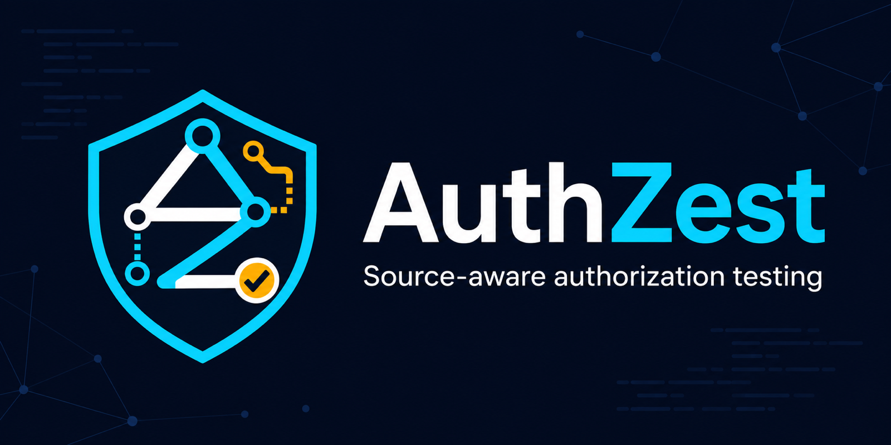

<p align="center">
  
</p>

<p align="center">
  <a href="../../../README.md">English</a> ·
  <a href="../ko/README.md">한국어</a> ·
  <strong>日本語</strong> ·
  <a href="../ru/README.md">Русский</a>
</p>

# AuthZest

AuthZest は、FastAPI アプリケーションのソースコードに基づいてアクセス制御を分析するための、
インストール可能な CLI 中心のオープンソースプロジェクトです。現在の Python コアは対象の
アプリケーションを import・実行せずにルートを収集します。中核となる製品目標は、Codex によるレビューと
防御的テスト・パッチの提案、ユーザーの承認または拒否、承認された変更のみの適用、別途承認された
隔離環境での検証と変更記録です。一般の FastAPI リポジトリ向けの新しい PoC 生成や、モデルによる
修正ソースの新規生成は未実装です。alpha.3 には明示的に選択する
所有 fixture のフローを含み、ソース CLI で実際の草案・適用・ランタイム検査・復元の確認が1回成功しました。静的スキャンは
引き続きオフラインで動作します。

現在の React ダッシュボードは静的スキャン結果を表示します。ローカル結果ビューアーは下記の
授業提出用安定版の目標に含まれ、当初の承認と実行は CLI が担当します。Web サイトのデプロイは不要です。

> [!NOTE]
> **授業提出用の完成版 `0.1.0` は計画段階であり、未リリースです。** 現在の alpha.4 は Codex で
> 登録済みの修正テンプレートを選択し、新しい PoC・テストコードやモデル作成の修正ソースを
> 生成するものでは**ありません**。安定版は、自ら保守・管理する FastAPI アプリのオブジェクト所有権
> シナリオ一つに限定し、アプリファイル一つ、新規生成テスト、明示的なインメモリポリシーを扱います。
> 目標デモは実際の Codex による PoC・テストと修正パッチの生成 → ユーザー承認後の新規コピー →
> 承認済み before/after 検証 → 復元で、ローカル結果 UI を含みます。動作するインストール手順と
> 一連のデモがリリース条件であり、現在の機能や一般リポジトリの修正対応を意味しません。
> [授業提出用安定版 (#150)](https://github.com/casing1/authzest/issues/150) と
> [開発計画](../../development/DEVELOPMENT_PLAN.md)で追跡します。

> [!IMPORTANT]
> **最新の公開リリース:**
> [v0.1.0-alpha.4](https://github.com/casing1/authzest/releases/tag/v0.1.0-alpha.4) は 2026-11-05 KST に公開されました。
> 正確なタグのソースは
> `090002d64d1ec5072c4e2ddf403a0e73e35d61ce`、Python パッケージ `0.1.0a4`、レポートスキーマ `1.2` です。
> [タグ workflow 41957416243](https://github.com/casing1/authzest/actions/runs/41957416243) の attempt 2 は、
> 公開を含む全 8 ジョブに合格し、公開ファイル 6 個をダウンロードして検証しました。
> 正確なコミットと検証結果は[変更履歴](../../../CHANGELOG.md)と[リリース記録](../../releases/RELEASING.md)を
> 確認してください。`main` の checkout は、このタグより先に進んでいる場合があります。
> まだアルファ段階のツールであり、完成した脆弱性スキャナーや一般リポジトリの修正フローではありません。

> [!NOTE]
> **一般的な修正エンジンではない限定範囲:** alpha.4 は読みやすい CLI と所有者ポリシーの推薦フローを
> 含みます。能動的な `codex-owner-repair --file-workflow` には POSIX non-frozen Python ソースの
> インストールが必要です。native バイナリは静的スキャンとオフラインプレビューに対応し、この能動的な
> ファイルフローには非対応です。授業提出用の安定版範囲 (#150) を優先します。独立評価 (#84) は
> 別途未完了のまま維持し、授業デモの固定 (#85) では結果または未取得の根拠を明示します。#130 で追跡する
> alpha.4 後のソース変更は、偽サーバーの完成したテストログを原子的に公開します。テスト harness の
> 信頼性変更であり、運用 Codex の修正や新たな実 AI 受け入れではありません。公開済み alpha.4 の
> タグと配布物は不変です。タグ attempt 1 は JSONL テスト harness の読み取り競合 1 件で失敗し、4,923 件合格・1 件失敗でした。
> ソースを変更しない再実行は合格しましたが、初回合格や修正完了ではありません。#89 の残存リスクは
> 下記の警告とともに **alpha.4 のみに** 受容され、`needs_review` / medium のまま未完了です。
> 修正済みや、その後の安定版に対する免除を意味しません。

> [!WARNING]
> **開発ツールのリスク (#89):** 影響を受ける Prettier は悪意ある EditorConfig により停止または失敗する可能性があります。
> レビュー済みのガード付き整形コマンドのみを使ってください。直接の `npx prettier`・エディター・API 連携は
> wrapper の保証範囲外で、未信頼設定の実際の流入と対応範囲内の AuthZest の可用性への影響は未確認です。
> AuthZest のランタイム脆弱性の確認や依存関係の修正を意味しません。[整形の境界と後続対応](../../development/FORMATTING.md#alpha4-maintainer-disposition--2026-11-05-kst)を参照してください。
> 次の alpha.4 の受容は将来の包括的な免除や AI/worker の許可ではありません。互換性のある upstream 修正や
> 新しい影響の証拠が得られた場合は、後続の検討が必要です。

## 現在のソースが対応する機能

- 静的に生成された `FastAPI`・`APIRouter` 所有オブジェクトと、対応範囲内の import 別名の認識
- Python [所有者ケース検討/固定計画 API](../../reference/OWNER_CASE_PLAN.md) は、
  正確なモデル草案と呼び出し元の未検討/承認/変更/拒否記録を結び付け、内蔵ポリシーの計画を
  表示します。記録された正確な期待値 10 件は 2026-10-09 KST に個別承認され、元のモデル作成履歴は
  保持されます。新しい CLI はなく、オフライン計画は実行不可・not-run・認可 unknown です。
  個別の[固定ポリシー検査 API](../../reference/OWNER_POLICY_CHECK.md) は #80 の範囲で、提供状況は
  [PR #97](https://github.com/casing1/authzest/pull/97) で追跡します。期待値の検討は実行・共有・パッチの権限を与えません。
  その後、個別承認された旧 recipe `1.0` の macOS arm64 ソース検査 1 回で期待値 10 件が一致しました。新しい AI 呼び出しは
  なく、認可は unknown です。
  Windows・frozen バイナリや endpoint 認可の受け入れ検証ではありません。その後、新たに個別承認された
  recipe `1.1` ソース検査も `e037986` で期待値 10 件が一致しました。二つの 1 回限りの承認は消費済みです。
  そのチェック時点では最終 head の CI・レビュー・提供は別の gate で、その後の結果は PR #97 で追跡します。
- 文字列リテラルの HTTP ルート検出と、対応するルーター・登録 prefix の合成
- リポジトリ内の絶対・相対ルーター import の接続と、元ファイル・行番号の保持
- `scan` コマンドによる読みやすい形式または JSON のレポート
- alpha.4 では `codex-owner-review`・`codex-owner-repair`・`codex-fixture`・`fixture-demo` を読みやすく
  表示します。`--json` は最終結果一つを stdout に出し、完全な同意プレビューと質問は stderr に
  出します。オフラインの `--preview-only --json` は owner-review または owner-repair の完全なプレビュー一つを返します。
  スクリプトは JSON を明示的に選び、フィールド・記録された判断・個別承認は変わりません。
  unknown は合格ではありません。[出力と移行の契約](../../guides/CODEX_OWNER_REVIEW.md#interpret-the-result)を
  参照してください。公開済み alpha.3 の表示は変更せず、GUI や新しい提供者/実行権限は追加しません
- 読み取り専用 [`authzest proposal-preview`](../../guides/PROPOSAL_PREVIEW.md) を提供：
  対応 POSIX システムで bundle の正確な diff・根拠・期待結果を表示し、承認や実行は行わない
- [`authzest proposal-check`](../../guides/PROPOSAL_CHECK.md) で、対応範囲内の変更前後の
  ソース snapshot と宣言の期待値を比較する。ソースは実行せず、ポリシーの意図は評価しない。
  一致しても認可を保証するものではない
- [`authzest review-demo`](../../guides/REVIEW_DEMO.md) は、メモリ内の mock 例一つで
  正確な diff・宣言の比較結果・文章のみのテスト草案をまとめて表示し、`--json` にも対応する。
  入力ファイル・プロバイダー・適用・実行はなく、実行時の認可検査ではない
- ソース checkout に[所有者限定レポートポリシー例](../../guides/OWNER_POLICY.md)を追加：純粋な
  所有者・scope ポリシー、独立した開発用単体テスト、別途スキャンする FastAPI 参照を提供する。
  実際の認証・endpoint の実行時テスト・新しい製品実行モードではない
- [`authzest codex-owner-review`](../../guides/CODEX_OWNER_REVIEW.md) を提供：すべての
  対応 OS で入力全体をオフラインで確認でき、正確な共有同意後、対応 POSIX システムで同梱の
  所有者ポリシー snapshot 二つを Codex が読み取り専用でレビューする。出力は未レビューの
  防御的テストケース草案であり、実行済みテストやパッチではない。過去2回の失敗後、新たに
  承認された2026-10-01の試行は約74秒で `draft-ready` を返し、回答1件とケース10件が
  host検証を通過した。限定的なプロバイダー受け入れ検証であり、期待値の承認やendpoint検証
  ではない。次の試行には新たな承認が必要で、公開済みalpha.3は変更しない
- [`authzest codex-owner-repair`](../../reference/OWNER_POLICY_REPAIR_RECOMMENDATION.md) を提供：
  対応 OS で共有内容全体をオフラインで確認でき、明示的な共有同意後、対応 POSIX システムで
  バージョン固定 App Server による試行を 1 回行う。候補は `before` または `after`、結果は
  `registered-change`・`no-change`・`unknown`。登録済みテンプレートの選択からホストが
  1 ファイルの diff を導出し、任意の置換コードは生成しない。2026-10-28 の個別承認された
  実連携 1 回で登録済みテンプレートが選択され、その承認は消費済み。既定は推薦のみで、適用・復元・ポリシー実行は行わない
- 別の[登録済み修正ポリシー検査 Python API](../../reference/OWNER_POLICY_REPAIR_CHECK.md) を提供：
  POSIX の Python ソースモードのみで、before/after の対照条件にはそれぞれ新たな個別承認が必要。
  過去の承認済み実行では、想定どおり before の 2 件の不一致と after の 8 件の一致を観測した。
  適用ファイルの検証ではない。この対照 API は下記のファイルフローとは別で、CLI/UI を追加しない
- [所有ファイル修正ソース API](../../reference/OWNER_POLICY_FILE_REPAIR.md#file-workflow-acceptance--2026-10-29-kst) を提供。
  2026-10-29 KST、main `fb90c46` でコピーから取得した before の検査、正確な diff の受け入れ、
  適用、取得した after の検査、復元をそれぞれ範囲を限定した承認の下で実施した。
  Before は期待値 6/8 件に一致し、`non-owner` と `exact-owner-no-normalization` の意図した
  過剰な許可 2 件を観測、after は 8/8 件に一致した。両検査は終了 `0`、後処理確認済みで、
  ファイル・証拠も確認済み。最終状態は `restored-before`、generation `3` で記録を保持した。
  以前の推薦を再検証し、新たな AI 呼び出しは行っていない。受け入れ検証は macOS/Python
  `3.12.7` の POSIX non-frozen API のみで、HTTP 認可や新しいインストール済み CLI フローの受け入れ検証ではない。
  その時点では #81/#35 全体と別途のリリース条件は未完了だった。alpha.3 は不変
- 明示的な [`codex-owner-repair --file-workflow` オプション](../../guides/OWNER_FILE_WORKFLOW.md)を提供。
  今回検証された推薦から新しい所有コピー、before 検査、正確な diff の受け入れ、適用、after 検査、
  復元へ進み、それぞれ個別の同意が必要。オプション自体は承認ではなく、`--preview-only` は引き続き
  共有入力のみを表示する。人向け出力は段階別の状態と 8 ケースの観察を分離し、`--json` は最終文書一つを保つ。
  CI とコード/セキュリティレビューを経て、PR #120 の `a0ae879` でソースの提供を完了した。
  以前のインストール済み推薦試行 2 回はコピー確認の期限切れ、または before worker の拒否で停止し、
  2 回目の stdout 収集は不完全だった。その後、新たに個別承認した `c868152` のインストールを
  macOS/Python `3.12.7` の 1 台で **2026-10-30 KST** に実行した。実際の推薦 1 回、
  新しい非公開コピー 1 個、before の 6/8 一致、正確な diff の受け入れ・適用、実際の適用バイトの
  after の 8/8 一致、正確な before バイトへの復元まで完了した（`restored-before`、generation `3`）。
  完全な最終 stdout JSON と stderr ログは非公開で保持し、元の checkout は clean のままだった。
  [限定されたインストール済みフローの記録](../../guides/OWNER_FILE_ACCEPTANCE.md)を参照。
  管理者は **2026-11-02 KST** に、登録済みの合成ポリシー対・8 ケース・Codex によるテンプレート
  選択・POSIX ソース CLI に限定した中核フローを受け入れた。上記の実行記録と既存のオフライン
  拒否・ユーザー編集・復元テストに基づく判断であり、新たな実環境での実行ではない。最終状態の文書は
  [PR #123](https://github.com/casing1/authzest/pull/123) の `ee49f5a` で通常マージされ、この限定された
  中核範囲で #82 → #81 → #35 を順に終了した。#84/#85/#89 は独立した未完了項目で、
  #83 の公開リリース検証記録は別である。#89 の残存リスクは alpha.4 のみに受容され、修正済みではない。
  Windows/frozen での能動的なファイル実行は
  引き続き未対応で、公開済み alpha.3 とレポートスキーマは不変
- [`authzest fixture-demo`](../../guides/FIXTURE_DEMO.md) を提供：対応 POSIX システムで、
  同梱のオフライン mock によるコピー適用・固定ソース検査・復元を個別に判断して体験できる。
  Codex・アカウント・ネットワーク・fixture ソース実行は不要で、公開済み alpha.3 は変更しない
- 既存の JSON フィールドを保持し、スキーマ `1.2`、構造化された診断、bounded/partial 状態と、
  元の宣言・app・`include_router` の根拠を伴う区別可能な登録 ID を追加
- ルートに直接宣言された `Depends`・`Security`、ソース位置と既知の scopes を収集。
  通常の依存性注入を認証や認可と判断しない
- 対応する app・router・`include_router` の依存関係宣言を各登録の適用文脈に結び付け、
  ルート直接宣言のリストと元のソース位置を別々に保持
- 静的スキャン用ローカル API・ダッシュボード、環境診断、独立した実行ファイルのパッケージング
- ソースと POSIX バイナリの [Codex fixture コマンド](../../guides/CODEX_FIXTURE.md)：明示的な共有、バージョン固定
  App Server、新しいコピー限定の正確な diff 承認。一つの fixture の実連携確認は成功済み
- 個別に承認するソース設定検査を既定とし、この AST 検査では fixture のソースを実行しない
- 明示的な [`--runtime-check`](../../guides/RUNTIME_VERIFICATION.md) は固定した所有 fixture のみを対象とし、
  同梱コードを実行して `app.debug` とメモリ内 ASGI `GET /health` を確認する。
  オプションの選択自体は実行承認ではありません。限定的な実ソース環境の受け入れ検証と alpha.3 の公開検査は合格しました

対応するデコレーターは `get`、`post`、`put`、`patch`、`delete`、`options`、`head` です。
静的解析の対応範囲は限定され、未解決のルート宣言は省略される場合があります。
対応するルートで依存関係の根拠が未解決の場合、ルートは診断とともにレポートに残ります。
構造化された診断は一部の未解決ケースとソース/読み取りエラーを扱いますが、すべての未対応パターンを
網羅するものではありません。空のレポートや `bounded` 状態は endpoint の不在やアクセス制御の安全性を
証明しません。[パーサーの対応範囲](../../reference/PARSER_SCOPE.md)と[レポート仕様](../../reference/REPORT_CONTRACT.md)を参照してください。
入れ子の依存関係グラフ、認証・認可の分類とセキュリティ finding は未実装です。
適用文脈の根拠はソース上の文脈であり、実行時の依存関係の順序や保護を保証しません。

`scan` は Codex adapter を無効にしたローカル静的解析を行います。Codex を呼び出さず、API key や
ChatGPT へのログインも不要です。別コマンドの `doctor` は、後述のとおりインストール済み Codex CLI を
呼び出す場合があります。

## ソースから CLI をインストール

最初に Python 3.12 以降と [pipx](https://pipx.pypa.io/latest/how-to/install-pipx.html) を用意してください。
開発の基準は Python 3.12 です。次のコマンドは
PyPI のパッケージではなく、現在のリポジトリソースを独立した pipx 環境にインストールします。

```bash
git clone https://github.com/casing1/authzest.git
cd authzest
pipx install --python 3.12 .

authzest --help
authzest scan /path/to/fastapi-project
authzest scan /path/to/fastapi-project --json
authzest scan /path/to/fastapi-project --json --strict
```

`/path/to/fastapi-project` を実際のプロジェクトディレクトリに置き換えてください。コマンドが PATH に
見つからない場合は `pipx ensurepath` を実行し、新しいターミナルを開きます。pipx でインストールした
CLI を使うために、プロジェクトの venv を有効にする必要はありません。
例では Python 3.12 を選択します。対応する別のインタープリターを使う場合は、`--python` の後の
`3.12` をそのバージョンまたは実行ファイルのパスに置き換えてください。

既定では部分的な解析でもレポートを返せば終了コードは 0 です。`--strict` を付けると、既知の部分解析では
レポートを出力したうえで 1 を返します。無効なリポジトリ入力には 2 を返します。
これらは解析の実行状態を示すコードであり、セキュリティの判定ではありません。

このソースインストールを更新するには、未コミットの変更がない `authzest` checkout の `main` で実行します。

```bash
git pull --ff-only
pipx install --force .
```

[ソースインストール CLI の事前検証記録](../../releases/RELEASING.md#source-installed-cli-preflight)には、
過去の `1d0ebb8` の同一バージョン置き換えを別途保持しています。2026-11-05 KST、macOS/Python 3.12
の 1 台の一時的な pipx 環境で、新しい `b5f3eb8` 候補のインストールが 13/13 件、実際の alpha.3
`99be6f5` / `0.1.0a3` から同じ pipx venv 内の `b5f3eb8` / `0.1.0a4` への置き換え後も 13/13 件に
合格しました。Noneditable のインストール元とインストール済みパッケージファイルのバイトを確認しました。
他の OS・クリーンな利用者端末・native インストーラー・UI の対応を立証するものではありません。
この検査では AI 呼び出し・ポリシー worker・能動的なファイルフローは実行しておらず、
以前の `c868152` の所有ファイルフローの観察とは別です。

最終ソース `090002d` は 2026-11-05 KST に別途検査しました。1 台の macOS/Python 3.12 環境で
新規インストールと実際の alpha.3 → alpha.4 置き換えが、それぞれオフラインのインストール済み CLI
検査 13/13 件に合格し、noneditable の出所とパッケージのバイトを確認しました。native 更新、他の
プラットフォームのインストール、新しい実所有ファイルフローの観察を意味しません。

ビルド済みファイルについては[独立した実行ファイル](#独立した実行ファイル)を参照してください。
`ui` extra は Python backend の依存関係をインストールしますが、通常の wheel・pipx インストールに
ビルド済みダッシュボードのアセットは含めません。任意のダッシュボードには、以下の editable ソース環境を使います。

## 同梱のサンプルを試す

リポジトリルートから、現在のソースのインストールで同梱のローカル fixture をスキャンします。

```bash
authzest scan examples/fastapi_inventory
authzest scan examples/fastapi_inventory --json
```

Python ファイル 4 個と `GET` ルート 3 個(`/health`、`/v1/catalog/items`、`/v2/catalog/items`)が得られます。
これは脆弱性の検出ではなく、静的な探索と同じルーターの繰り返し登録を示すサンプルです。
fixture の構成と期待する根拠は[サンプルガイド](../../guides/EXAMPLES.md)を参照してください。

## CLI 診断

```bash
authzest --version
authzest doctor
authzest doctor --json
```

`doctor` は Python の実行環境を確認します。PATH 上に `codex` が見つかると、`codex --version` と
`codex login status` も subprocess として実行します。AI スキャンを開始したり、認証情報ファイルを
直接読んだりはしません。Codex やログインがなくても警告にとどまり、静的スキャンは利用できます。
ログイン成功は AI スキャンやデータ共有への同意を意味しません。別の
[Codex fixture コマンド](../../guides/CODEX_FIXTURE.md) は明示的な共有承認を要求し、所有 fixture のみを扱います。

## 開発環境

clone したリポジトリのルートで実行してください。例は macOS/Linux shell 向けです。Windows PowerShell
では `py -3.12 -m venv .venv` で venv を作成し、`.venv\Scripts\Activate.ps1` で有効にします。

```bash
python3.12 -m venv .venv
source .venv/bin/activate
python -m pip install -e '.[dev]'
```

editable インストールはこの checkout を使い、`dev` extra には任意の backend 依存関係も含まれます。
Node.js/npm は frontend の作業、ドキュメントの検証、ダッシュボードを含むビルドに必要です。
CI は Node.js 22 を使います。

## 任意のローカルダッシュボード

以下は現在の静的スキャン UI の起動手順であり、計画中の生成 PoC・修正結果ビューアーではありません。

editable 開発環境を準備した後、リポジトリルートからダッシュボードをビルド・起動します。

```bash
npm --prefix frontend ci
npm --prefix frontend run build
authzest ui --workspace /path/to/fastapi-project --host 127.0.0.1 --port 8000
```

[http://127.0.0.1:8000](http://127.0.0.1:8000) を開いてください。editable backend は checkout 内の
`frontend/dist` を参照します。ビルドがない場合、`/` にはダッシュボードではなく API の案内が表示されます。

ダッシュボードは未実行・空の結果・部分的なスキャンを区別し、構造化された診断と parse-error の詳細を表示します。
再スキャンに失敗すると前の結果を消去します。これらは収集状態であり、アクセス制御の判定ではありません。

frontend 開発時は、venv が有効なターミナルで
`authzest ui --workspace /path/to/fastapi-project --reload` を実行し、リポジトリルートの別ターミナルで
`npm --prefix frontend run dev` を実行してください。[http://localhost:5173](http://localhost:5173) を
開くと、Vite が `/api` と `/health` をポート 8000 に転送します。

ローカルサーバーは `GET /health`、`GET /api/health`、`POST /api/scans` と、`/docs` の API ドキュメントを
提供します。スキャン endpoint は必ずサーバー起動時に選択した workspace を使い、リクエスト本文で別の
パスを選ぶことはできません。直接の CLI スキャンはローカルユーザーが指定したパスを使います。
任意のサーバーは loopback アドレスで実行してください。

## 検証

開発 venv を有効にして実行します。

```bash
python -m pytest
ruff check .
ruff format --check .
```

frontend を変更した場合は、以下も実行してください。

```bash
npm --prefix frontend ci
npm --prefix frontend run lint
npm --prefix frontend run format:check
npm --prefix frontend run build
```

ドキュメントを変更した場合は、上記の frontend 依存関係をインストールしてからリポジトリルートで実行します。

```bash
node --test scripts/check_docs.test.mjs
node --test scripts/format.test.mjs
node scripts/check_docs.mjs
node scripts/format.mjs markdown --check
```

検査ツールはドキュメントの実行例を実行せず、翻訳ペア、ローカルリンク、コマンドの一致を確認します。
整形コマンドは Git が追跡する Markdown が対象なので、新しいガイドは最終確認の前に staging に含めてください。
[整形ガイド（英語）](../../development/FORMATTING.md)で、書き込みコマンド、維持するルート
EditorConfig、およびガードの制限を確認してください。

## 独立した実行ファイル

[alpha.4 リリース](https://github.com/casing1/authzest/releases/tag/v0.1.0-alpha.4) は Linux x64、
macOS arm64、Windows x64 の実行ファイルと SHA-256 manifest、静的一覧・読みやすい出力・所有者
レビュー/修正のオフラインプレビューを提供します。タグ workflow attempt 2 の全 8 ジョブが合格しました。
各プラットフォームは選択/移動 26 件・パッケージ 13 件・新規ダウンロード 13 件のスキャン/プレビューと、
固定 runtime parent 検査 2/1/1 件に合格しました（POSIX は AFTER debug/health のみ、Windows は明示的な非対応）。
公開ファイル 6 個のバイトが attempt 2 成果物と GitHub API SHA-256 に一致し、checksum sidecar 3 個も
バイナリに一致しました。移動した公開 macOS バイナリは Python `-I -S` の標準ライブラリ制御プログラムで
スキャン/プレビュー 13 件・固定 runtime 1 件に合格しました。Codex・対象・パッチは使っていません。
公開・公開ダウンロードの検証は完了し、文書の提供は [#83](https://github.com/casing1/authzest/issues/83) で
追跡します。[公開検証記録](https://github.com/casing1/authzest/issues/83#issuecomment-6648591185)と
[リリースガイド](../../releases/RELEASING.md)を参照してください。
GUI インストーラーではなく独立した CLI プログラムであり、
ビルド済みバイナリの実行に Python や Node.js のインストールは不要です。POSIX バイナリには
所有 fixture のフローとランタイム依存関係も含まれます。Codex は独自のログインを使う別の信頼できる
インストールが必要で、ソース共有と各変更・検査は個別に承認します。Windows の fixture 適用・
ランタイム検査は非対応であり、ランタイム検査の合格を意味しません。

OS/アーキテクチャに合うファイルと `.sha256` manifest をダウンロードし、実行前に
[チェックサムと実行の手順](../../releases/RELEASING.md#verify-and-recover)に従ってください。
過去の alpha.3 では、3 プラットフォームの CI ビルドと新しいジョブでの成果物 smoke 検査が成功し、公開ファイル6個を
ダウンロードして検査済み成果物と照合しました。公開 macOS バイナリも Python `-I -S` の標準
ライブラリ制御プログラムでプロジェクト依存関係を import せず、ローカルのスキャン・ランタイム smoke に合格しました。これらのパッケージ検査では
実際の Codex 呼び出しは行っていません。一般ユーザーの機器での
クリーンインストール・アップグレードや、すべての OS バージョンとの互換性は未確認です。署名・公証は
されていないため、OS が未確認の発行元について警告する場合があります。

現在のソースの native パッケージには静的スキャンとオフラインの所有者プレビューを含みますが、
能動的な `codex-owner-repair --file-workflow` は含みません。この経路には POSIX non-frozen の
Python ソースインストールが必要です。2026-11-05 KST の [native プレビュー実行 41946366368](https://github.com/casing1/authzest/actions/runs/41946366368)、
attempt 1 は正確なソース `b5f3eb81d318e94c5e400ec52e78f1550e13f931` で 7/7 ジョブに合格しました。
Linux x64・macOS arm64・Windows x64 のそれぞれで、選択・移動 26 件、パッケージ 13 件、同じ OS の
新規ダウンロード 13 件の検査に合格しました。バイナリ・チェックサム manifest の 3 組もローカルに
ダウンロードしてすべて照合し、ローカルでのバイナリ実行は行っていません。これはスキャン・プレビューの
証拠であり、UI・ランタイム・AI・ポリシー worker・能動的なファイルフローの受け入れではありません。
このソースだけに結び付いた観察で、後続の文書マージは新たに検査した候補ではありません。
これは過去の事前検証であり、alpha.4 の公開ダウンロード検証記録ではありません。

正確な alpha.4 ソース `090002d` は別途
[非公開のリリース事前検証 41955210082](https://github.com/casing1/authzest/actions/runs/41955210082) で
7 ジョブに合格し、公開はスキップされました。パッケージの runtime 検査は POSIX の固定所有 AFTER
fixture の debug/health のみで、Windows は明示的な非対応動作を検査します。全体の回帰検査は
保守対象の BEFORE/AFTER fixture も実行し、任意のリポジトリは実行しません。タグ公開と公開ファイルは
リリースガイドの別の観察です。UI の受け入れ、利用者端末でのインストール/更新、署名/公証、native の
能動的な所有ファイルフローの対応を立証するものではありません。

現在のソースをローカルでビルドするには、開発 venv を有効にし、リポジトリルートから実行します。

```bash
python -m pip install -e '.[build]'
npm --prefix frontend ci
npm --prefix frontend run build
python -m PyInstaller --clean --noconfirm authzest.spec
./dist/authzest --help
```

Windows の出力は `dist\authzest.exe` です。PyInstaller は `frontend/dist` が存在する場合に同梱します。
タグの検証、checksum、公開手順については[リリースガイド](../../releases/RELEASING.md)を参照してください。

## プロジェクト構成

```text
src/authzest/
├── analyzer/   # リポジトリ解析と集約
├── parser/     # AST ルート・import の解決
├── runner/     # 共通のスキャン実行フロー
├── codex/      # オフライン契約と opt-in 所有 fixture adapter; scan はオフライン
├── cli.py      # Typer コマンドラインインターフェース
├── api/        # 任意の FastAPI 接続層
└── models.py   # コアのレポートデータ
tests/          # 回帰テスト
frontend/       # 現在の静的スキャン用 React/Vite/TypeScript ダッシュボード
docs/           # ガイド、翻訳、アセット
scripts/        # リリース補助ツール
.github/        # CI/リリース workflow とコントリビューションのテンプレート
```

CLI と任意の API・UI は同じコアを使います。コア解析は Web サーバー、React、特定の AI provider に
依存してはいけません。

## ロードマップとコントリビューション

- [ドキュメント索引](../../README.md) — 英語のガイドと韓国語訳
- [開発チェックリスト](../../development/DEVELOPMENT_PLAN.md)と[ロードマップ issue #1](https://github.com/casing1/authzest/issues/1)
- [モデルと評価の方針](../../development/MODEL_STRATEGY.md)
- [コントリビューションとコミットのルール](../../../CONTRIBUTING.md)

範囲を定めたタスクを issue で追跡し、短期間のブランチで開発して、意味のあるコミットと検証を含む PR を
作成してください。保護された `main` は Python、frontend、CodeQL のチェックを要求します。自由テーマの
既存の開発 7 週間には完了済みの作業を含みます。新しい 7 週間は開始せず、提出見込みの
2026-11-18 より前の試験・提出の余裕を保持します。
[#32](https://github.com/casing1/authzest/issues/32) のレポート・根拠の基盤と
[#28](https://github.com/casing1/authzest/issues/28)・[#29](https://github.com/casing1/authzest/issues/29) の
ルート直接・継承宣言の根拠は alpha.2 に含まれます。
リリース準備・公開 [#39](https://github.com/casing1/authzest/issues/39) は完了しました。
後続の [alpha.3 チェックポイント](https://github.com/casing1/authzest/releases/tag/v0.1.0-alpha.3)も公開・検証済みです。
現在のソースと次の作業は以下のとおりです。

1. ソースに実装済み: [#33: 根拠に結び付いたオフライン AI 契約・mock・評価](https://github.com/casing1/authzest/issues/33)。
2. 受け入れた限定的な中核範囲で終了: [#35: Codex 提案・正確な diff の承認・承認済みパッチの適用・隔離検証](https://github.com/casing1/authzest/issues/35)。
3. 同梱されたソース専用の能動的なフロー: [#82: 読みやすいインストール型 CLI 統合](https://github.com/casing1/authzest/issues/82)に
   opt-in のファイルフローとオフラインテストを PR #120 で提供しました。個別承認した 1 台の
   インストール済み正常系で、推薦から適用ファイルの検査・復元まで観測しました。管理者は
   2026-11-02 KST に[限定された中核フローと既存のオフライン証拠](../../guides/OWNER_FILE_ACCEPTANCE.md)を
   受け入れました。新たな実環境での実行や一般リポジトリの修正の受け入れではありません。最終状態の
   文書は PR #123（`ee49f5a`）で通常マージされ、この範囲で #82 → #81 → #35 を順に終了しました。
4. ソースのテスト harness 安定化の提供は [#130](https://github.com/casing1/authzest/issues/130)で追跡します。
   次は [#150 授業提出用完成版](https://github.com/casing1/authzest/issues/150)の実際の生成 #151 →
   承認済みコピーの検証/復元 #152 → ローカル結果 UI #153 →
   [#85 再現可能なデモ・授業提出の証拠](https://github.com/casing1/authzest/issues/85)です。
   [#84 独立評価](https://github.com/casing1/authzest/issues/84)は別途未完了のまま維持し、比較の根拠が
   なければ明示します。中核の提供より比較実行基盤の拡張を優先しません。
   [#83 の正確なリリース/公開ファイル検証記録](https://github.com/casing1/authzest/issues/83)は別に保持します。
   #89 は `needs_review` / medium のまま未完了で、alpha.4 限定のリスク受容は修正や安定版の免除ではありません。
   限定した `0.1.0` 安定版には実際の生成フロー・UI・デモ・回帰/インストール検証と新たなリスク判断が
   必要であり、現在の alpha がこれらを実装済みという意味ではありません。

[オフライン基盤](../../reference/AI_CONTRACT.md) は alpha.3 の fixture コマンドが使う契約を提供します。
評価スクリプトとデータセットは checkout 専用のままです。上記の限定された中核フローの受け入れは、
一般の FastAPI 向け PoC 生成やモデルによる修正ソースの新規生成の実装を意味しません。
#35 の最初の段階である [#46 のオフライン提案・判断契約](../../reference/PROPOSAL_CONTRACT.md) はソースに実装済みです。
diff のプレビューと模擬承認の検査を提供しますが、ファイルへの適用や検証の実行は行いません。
後続の [#48 コピー専用適用デモ](../../guides/FIXTURE_APPLICATION.md) は、新しい POSIX fixture コピーで
明示的な端末承認と競合を確認する復元を提供します。元の checkout は変更せず、実際の AI 呼び出しや
検証は実行しない checkout 専用スクリプトです。コピー helper は alpha.3 の製品コマンドでも使います。
後続の [#50 Codex fixture 段階](../../guides/CODEX_FIXTURE.md) は明示的な共有承認後にモデル草案を
一度要求し、適用と復元は別途判断します。`42ff108` で一つの所有 fixture の実際の草案・コピー適用・
復元の確認が1回成功し、元の内容は保持されました。承認文はユーザーの許可に基づき assistant が
入力したもので、独立した人間のレビューではありません。この過去の実行ではランタイム検証を
行っていません。これらの製品機能は alpha.2 ではなく alpha.3 に含まれます。#52 は適用と復元の間に、別途承認する
既知のハッシュに固定したソースの AST 設定検査を制限付き子プロセスで行う選択肢を追加します。対象ソースを実行せず、
新たな実モデルの証拠や、セキュリティ修正の有効性が検証済みという主張も追加しません。
#54 は `--runtime-check` で[所有 fixture のランタイム計画](../../guides/RUNTIME_VERIFICATION.md)を追加します。
別途の正確な検証確認、制限付き worker、任意の依存パッケージを使い、自動インストールは行いません。
限定的な実ソース環境の受け入れ検証に合格し、alpha.3 の公開ファイルも別のリリース検査に合格しました。
一般リポジトリの AI レビューは未実装です。その後の限定された中核フローの受け入れは、任意の
リポジトリや新規生成された修正ソースまで範囲を広げるものではありません。
6 ケース・3 モードの mock 評価はモデル性能ではなく契約を検証します。AI 支援が結果を改善するかは実証済みの利点ではなく、評価すべき
仮説です。コアは provider や特定の GPT モデルがなくても役立つものにします。
最終デモは自ら所有・管理する fixture を対象とし、データ共有・パッチ・実行を別々に許可します。
脆弱性を悪用する PoC の生成、自律的な攻撃フロー、任意のリポジトリの実行は対象外です。

## ライセンスとセキュリティ

AuthZest は [MIT License](../../../LICENSE) を採用しています。脆弱性は公開 issue ではなく、
[セキュリティポリシー](../../../SECURITY.md)に記載された非公開の手順で報告してください。
