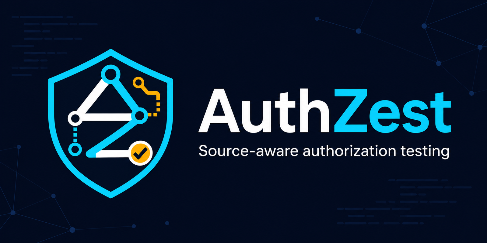

<p align="center">
  
</p>

<p align="center">
  <a href="../../../README.md">English</a> ·
  <strong>한국어</strong> ·
  <a href="../ja/README.md">日本語</a> ·
  <a href="../ru/README.md">Русский</a>
</p>

# AuthZest

AuthZest는 Python CLI와 로컬 웹 대시보드를 제공하는 FastAPI 접근통제 테스트 오픈소스 프로젝트입니다.
소스 선언을 오프라인으로 확인하거나, Codex로 관리 대상인 소유자의 보관 노트 사례에 대한 방어적
회귀 테스트와 수정안을 제안받을 수 있습니다. 각 단계를 검토한 뒤 비공개 복사본을 검사·변경·복구합니다.

**이 README는 0.1.0 소스의 지원 범위를 설명합니다.** 패키지 버전은 `0.1.0`이며 패키지 정보만으로
공개 발행 여부를 판단할 수는 없습니다. 제공되는 태그·파일·체크섬은
[GitHub Releases](https://github.com/casing1/authzest/releases)를 확인하세요. 앞서 2026-11-05 KST에 발행한
[v0.1.0-alpha.4](https://github.com/casing1/authzest/releases/tag/v0.1.0-alpha.4)는 현재 GUI와 새 owner-read
수정 코드 생성 흐름이 추가되기 전의 버전입니다.
[0.1.0 안내](releases/0.1.0.md) · [최종 준비 상태](releases/0.1.0-READINESS.md) · [변경 이력](CHANGELOG.md)

**외부 프로젝트 지원을 완성할 때까지 정식 발행을 보류합니다.** 현재 소스에 추가한
`repo-suggest`는 외부 폴더에서 명시한 Python 소스·정책·선택 문맥으로 미실행 테스트·수정 제안과
정확한 diff를 반환하는 CLI 단계입니다. 외부 복사본 적용·전후 실행 검사·GUI 연결은 후속이며,
아래 활성 GUI는 여전히 내장 사례를 사용합니다. [외부 프로젝트 안내](guides/REPOSITORY_PROPOSALS.md)

## 사용할 수 있는 기능

| 기능               | 현재 소스의 동작                                                                                                                                                                                        |
| ------------------ | ------------------------------------------------------------------------------------------------------------------------------------------------------------------------------------------------------- |
| 정적 소스 스캔     | 대상 앱을 import하거나 실행하지 않고 지원 범위의 FastAPI·라우터 선언, prefix와 의존성을 탐색합니다. 소스 위치, 진단과 부분 분석 상태를 확인합니다.                                                      |
| AI 제안            | 공유할 내장 소스와 정책을 정확히 미리 본 뒤, 기존 Codex 어댑터를 통해 새 방어적 테스트와 파일 하나의 가용성 규칙 수정을 요청합니다. 변경 없음과 불명도 정상적인 결과입니다.                             |
| 검토형 복사본 작업 | 런타임·공유·복사·before·diff·적용·after·복구를 각각 검토하고 결정합니다. 검토한 네트워크 차단 Linux guest에서 생성 회귀 테스트와 관리 대상 대조 7개를 검사하며, 새 비공개 복사본에만 변경을 적용합니다. |
| 로컬 GUI           | CLI와 같은 owner-read 엔진에 현재 확인 문구로 결정을 전달합니다. 생성 코드·diff·before/after·복구 상태를 확인하고 전체 JSON을 내려받습니다. 일반 실행은 정적 목록과 저장 결과 보기를 지원합니다.        |

AI 흐름의 대상은 **직접 관리하는 합성 시나리오 하나**입니다. 정적 스캔을 위해 선택한 저장소를
Codex에 자동 전송하거나 수정하지 않습니다. 일반 저장소 수정과 임의 애플리케이션 실행은 지원 범위에
포함되지 않습니다. [작업 흐름 계약](development/GENERATED_REPAIR_CONTRACT.md)

## 빠른 시작: 로컬 대시보드

현재 대시보드에는 편집 가능한 소스 checkout을 사용합니다. 아래 명령은 Python 3.12와 Node.js
22.x의 22.13 이상 또는 Node.js 24, npm을 갖춘 macOS·Linux 환경을 기준으로 합니다.

```bash
git clone https://github.com/casing1/authzest.git
cd authzest
python3.12 -m venv .venv
.venv/bin/python -m pip install -e '.[ui]'
npm --prefix frontend ci
npm --prefix frontend run build
.venv/bin/authzest scan examples/fastapi_inventory
.venv/bin/authzest ui --workspace examples/fastapi_inventory
```

[로컬 대시보드](http://127.0.0.1:8000)를 엽니다. 이 실행은 읽기 전용이며 예제의 Python 파일 4개와
GET 등록 3개를 확인하거나 저장한 작업 흐름 JSON을 선택할 수 있습니다. 웹사이트 배포는 필요하지
않습니다. `.venv`와 `frontend`가 있는 복제한 저장소 디렉터리에서 명령을 실행하세요.
Ctrl-C로 서버를 종료합니다. 프런트엔드 소스를 변경했다면 다시 빌드합니다.

## GUI에서 AI 보조 수정 실행

이 모드에는 POSIX non-frozen 소스 설치, 기존 Codex ChatGPT 로그인, 검토한 owner-read Docker
런타임 설정과 이미지가 필요합니다. 현재 어댑터에는 신뢰하는 Codex CLI 버전 `0.153.0`이 필요합니다.
시작 전에
[런타임 준비 안내](development/GENERATED_REPAIR_CONTRACT.md#승인형-복사본-흐름-실행)를 따릅니다.
아래 설정 경로는 비공개 파일의 절대 경로로 바꿔야 하는 자리표시자입니다.

```bash
.venv/bin/authzest ui --workspace examples/fastapi_inventory --ai-runtime-config /ABSOLUTE/PRIVATE/runtime.json
```

1. 터미널에 출력된 **비공개 AI 작업 공간 URL 전체**를 **새 브라우저 탭**에서 엽니다. 처음 여는
   URL에는 `authzest-ai` fragment를 포함합니다. 화면은 이를 제거하고 접속 권한을 메모리에만
   유지합니다. 새로고침한 뒤에는 전체 실행 URL로 다시 열고, 서버를 재시작하면 새 URL을 사용합니다.
2. AI 수정 화면에서 필요하면 기존 로그인을 확인하고 접근 가능한 정확한 모델 식별자를 입력합니다.
   실행을 준비하면 런타임 계획을 표시하며 공유를 승인하지는 않습니다.
3. 각 현재 전체 계획을 검토하고 그 단계의 정확한 확인 문구를 입력합니다. 순서는 **runtime → share
   → copy → before → diff → apply → after → restore**입니다. 결정은 각각 별도이며 1회용이고 만료됩니다.
4. 생성 회귀 테스트, 소스 변경, 정확한 diff, 관찰값과 복구 상태를 확인합니다. 호스트 활동은 작업
   단계 기록이며 실시간 Codex 토큰 스트림이나 원본 계정 로그가 아닙니다.
5. 다른 실행을 시작하거나 서버를 닫기 전에 결과 JSON을 찾기 쉬운 비공개 폴더에 내려받습니다.
   저장 위치는 브라우저의 다운로드 설정과 목록에서 확인합니다. 복구가 필요하면 기록된 복구 파일을
   보존합니다. 완료·실패한 실행은 반복 세션 조회를 멈추고 새
   활성 실행이 시작되면 갱신을 재개합니다.

관리하는 사례에서 기대하는 비교 결과는 다음과 같습니다.

| 단계   | 소유자의 보관 노트 조회 | 생성 회귀 테스트 | 의도한 정책 일치 |
| ------ | ----------------------- | ---------------- | ---------------- |
| Before | HTTP 403, 잘못된 거절   | 단언 실패        | 6/7              |
| After  | HTTP 200                | 통과             | 7/7              |

이 표는 fixture의 의도한 시연을 설명하며 새 모델 응답의 결과를 보장하지 않습니다. 별도의 기대
프로필 일치는 두 단계 모두 7/7일 수 있습니다. 복구와 정리도 함께 확인하세요. 앞선 테스트가
통과했어도 복구 필요 상태가 해소되지는 않습니다. 적용 후 중단하면 비공개 복사본에 수정이 남을 수
있으며 자동으로 복구하지 않습니다. 원본 checkout은 이 작업 흐름의 쓰기 범위 밖에 있습니다.

활성 모드는 숫자 loopback `127.0.0.1`, 단일 프로세스, reload 없음으로 실행합니다. 일반 대시보드
접속·저장 JSON·Vite 개발 프록시는 활성 권한을 부여하지 않습니다. workspace는 정적 스캔 루트만
선택합니다. [GUI 안내](guides/RESULT_VIEWER.md) · [과제 시연](guides/COURSE_DEMO.md)

## CLI 대안

CLI만 사용하려면 Python 3.12와 pipx를 설치한 뒤 소스 checkout에서 실행합니다.

```bash
pipx install --python 3.12 .
authzest --help
authzest scan /path/to/fastapi-project
authzest scan /path/to/fastapi-project --json
authzest scan /path/to/fastapi-project --json --strict
```

예제 경로를 바꿉니다. 필요하면 `pipx ensurepath`를 실행하고 터미널을 다시 엽니다. 정적 스캔은
Codex 없이 동작합니다. 부분 보고서를 반환하면 기본 종료 코드는 0입니다. 알려진 부분 분석은
`--strict`에서 1을, 잘못된 입력은 2를 반환합니다. 이는 실행 상태이며 보안 판정이 아닙니다.

빠른 시작에서 만든 편집 가능 `.venv` 환경을 사용하면 owner-read CLI에서 공유나 실행 없이 전체
요청을 미리 볼 수 있습니다.

```bash
.venv/bin/authzest owner-read-suggest --model EXPLICIT_MODEL --file-workflow --runtime-config /ABSOLUTE/PRIVATE/runtime.json --preview-only
```

`EXPLICIT_MODEL`과 런타임 경로를 검토한 값으로 바꿉니다. 대화형 CLI 실행, 비공개 JSON 저장과
기존 등록 템플릿 도구는 [과제 안내](guides/COURSE_DEMO.md)와 [명령 안내](INDEX.md)를 참고하세요.

## 설치 범위

| 설치 경로                                   | 지원 용도                                                                                                                                |
| ------------------------------------------- | ---------------------------------------------------------------------------------------------------------------------------------------- |
| 편집 가능 소스 + UI extra + 프런트엔드 빌드 | 현재 대시보드, 검토한 런타임을 갖춘 지원 POSIX 시스템의 활성 owner-read GUI·CLI.                                                         |
| 일반 wheel 또는 소스에서 설치한 pipx CLI    | CLI 명령. 빌드한 대시보드 자산은 포함하지 않으므로 GUI는 편집 가능 checkout 경로를 사용합니다.                                           |
| 태그별 독립 실행 파일                       | 실험적 정적 스캔·오프라인 미리보기. 대시보드 제공 여부는 선택한 태그의 안내를 확인하세요. 활성 owner-read GUI·CLI에는 소스가 필요합니다. |

공개 파일과 체크섬은 [GitHub Releases](https://github.com/casing1/authzest/releases)를 확인하세요.
실행 파일에는 서명과 notarization이 적용되지 않았습니다. 현재 소스의 네이티브 빌드와 기록된 플랫폼
검사는 [릴리스 안내](releases/RELEASING.md)에 정리돼 있으며 과거 검사가 이후 후보를 인증하지는
않습니다. PyPI·npm 발행은 현재 릴리스 절차에 포함되지 않습니다.

## CLI 진단

```bash
authzest --version
authzest doctor
authzest doctor --json
```

진단 명령은 Python과 PATH에 있는 Codex의 버전·로그인 상태를 확인합니다. 모델 요청을 시작하지
않습니다. 로그인만으로 소스 공유나 파일 단계 결정 권한이 생기지 않습니다. Codex가 없어도 정적
스캔은 사용할 수 있습니다.

## 개발 환경

저장소 루트에서 개발 환경을 만듭니다.

```bash
python3.12 -m venv .venv
source .venv/bin/activate
python -m pip install -e '.[dev]'
```

Windows PowerShell에서 플랫폼에 독립적인 CLI를 개발할 때는 `py -3.12 -m venv .venv`와
`.venv\Scripts\Activate.ps1`을 사용합니다. 활성 owner-read 실행과 작업 GUI는 POSIX 소스에서만
지원합니다.

## 검증

개발 환경을 활성화한 상태에서 실행합니다.

```bash
python -m pytest
ruff check .
ruff format --check .
npm --prefix frontend ci
npm --prefix frontend test
npm --prefix frontend run lint
npm --prefix frontend run format:check
npm --prefix frontend run build
node --test scripts/check_docs.test.mjs
node scripts/check_docs.mjs
node scripts/format.mjs markdown --check
```

문서 검사는 예제를 실행하지 않고 링크, 번역 간 명령 일치와 셸 문법을 확인합니다.
[검증을 거치는 포맷 명령](development/FORMATTING.md)을 사용하세요. 개발 도구 권고와 후보별 판단은
[#89](https://github.com/casing1/authzest/issues/89)·[#171](https://github.com/casing1/authzest/issues/171)에서
계속 추적합니다. 편집기·API에서 직접 포맷하는 경우는 이 wrapper의 범위 밖에 있습니다.

## 구조와 추가 안내

Python core, parser/analyzer, Codex 어댑터, runner와 표시 계층을 분리합니다. Typer CLI와
FastAPI·React UI는 같은 핵심 작업 흐름을 사용하며 UI 변경이 새 실행·소스 공유 권한을 부여하지
않습니다.

- [문서 목차](INDEX.md): 명령 계약, 설치와 참조 API.
- [개발 계획](development/DEVELOPMENT_PLAN.md): 현재 범위와 과거 개발 기록.
- [과제 시연](guides/COURSE_DEMO.md): GUI·CLI·저장 결과 발표.
- [기여 안내](CONTRIBUTING.md): 의미 있는 커밋, 테스트, 라벨과 브랜치 규칙.
- [보안 정책](SECURITY.md): 제보와 지원 검토 범위.
- [MIT 라이선스](../../../LICENSE).

정적 선언, 제공한 정책과 유한 테스트 결과는 서로 다른 근거입니다. 진단과 불명·미실행·거절·실패
상태를 표시합니다. AuthZest가 일반적인 접근통제 안전성, 운영 환경의 격리나 측정된 모델 성능 우위를
입증하지는 않습니다. 독립 비교는 [#84](https://github.com/casing1/authzest/issues/84), 과제용 정식판
전달은 [#150](https://github.com/casing1/authzest/issues/150)에서 추적합니다.
