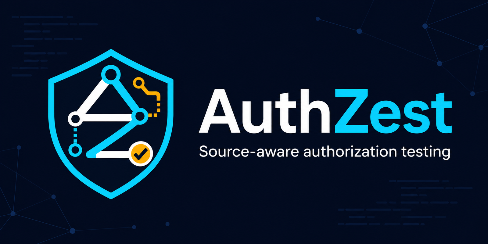

<p align="center">
  
</p>

<p align="center">
  <a href="../../../README.md">English</a> ·
  <a href="../ko/README.md">한국어</a> ·
  <a href="../ja/README.md">日本語</a> ·
  <strong>Русский</strong>
</p>

# AuthZest

AuthZest — проект с открытым исходным кодом для тестирования авторизации в FastAPI, с CLI на Python
и локальной веб-панелью. Для одного самодостаточного файла FastAPI в другой папке `repo-fix` запрашивает
у Codex HTTP proof-of-concept и исправление дефекта владения объектом в GET-запросе. Точный исходный код
до и после исправления проверяется в изолированных контейнерах по просмотренным вами случаям, и только
после этого предлагается записать исходный файл с сохранением резервной копии. Статическое сканирование
объявлений и встроенный сценарий чтения владельцем по-прежнему доступны.

**Этот README описывает область поддержки исходного кода 0.1.0.** Версия пакета — `0.1.0`;
метаданные пакета сами по себе не подтверждают публикацию. Доступные теги, файлы и контрольные суммы
проверяйте в [GitHub Releases](https://github.com/casing1/authzest/releases). Более ранний
[v0.1.0-alpha.4](https://github.com/casing1/authzest/releases/tag/v0.1.0-alpha.4), опубликованный 2026-11-05 KST,
предшествует текущему GUI и процессу исправления чтения владельцем с генерацией нового кода.
[Примечания к 0.1.0](../../releases/0.1.0.md) · [Итоговая готовность](../../releases/0.1.0-READINESS.md) · [История изменений](../../../CHANGELOG.md)

**Состояние — 2026-11-25 KST.** На прилагаемом демо внешний процесс выполнен полностью с реальной моделью
Codex и Docker Desktop. PoC модели воспроизвёл проверенный дефект (5/5 случаев до исправления), исправление
совпало со всеми 5 случаями после исправления, а исходный файл был записан с резервной копией. Когда
пользователь затем изменил файл, `repo-restore` отказал в восстановлении, а после отмены правки вернул
исходные байты. Затем тот же процесс снова прошёл из свежей установки wheel: новые PoC и исправление,
5/5 до и после, запись и восстановление установленным `repo-restore`. Стабильная публикация ждёт
оставшихся проверок выпуска. [Руководство по внешнему исправлению (англ.)](../../guides/REPOSITORY_HTTP_FIX.md)

## Возможности

| Функция                      | Поведение текущего исходного кода                                                                                                                                                                                                                                                               |
| ---------------------------- | ----------------------------------------------------------------------------------------------------------------------------------------------------------------------------------------------------------------------------------------------------------------------------------------------- |
| Исправление внешнего файла   | `repo-fix`: передать выбранный файл и политику, получить GET PoC и исправление, выполнить изолированные проверки до и после по вашим просмотренным случаям, затем одобрить запись исходного файла с резервной копией, отказом при конфликте и восстановлением через `repo-restore`.             |
| Статическое сканирование     | Обнаруживает поддерживаемые объявления FastAPI/router, префиксы и зависимости без импорта и выполнения целевого приложения. Показывает расположение в исходниках, диагностику и состояние частичного анализа.                                                                                   |
| Предложение ИИ               | Показывает точный исходный код и политику из пакета, затем через существующий адаптер Codex запрашивает новый защитный тест и исправление правила доступности в одном файле. Отсутствие изменений и неопределённый результат также допустимы.                                                   |
| Процесс на проверяемой копии | Отдельные решения для runtime, передачи исходников, копирования, before, diff, применения, after и восстановления. Сгенерированный регрессионный тест и семь поддерживаемых контрольных случаев выполняются в проверенных Linux guest без сети. Изменяется только новая приватная копия.        |
| Локальный GUI                | Тот же механизм чтения владельцем с вводом текущих подтверждений. Показывает сгенерированный код, diff, before/after и состояние восстановления; позволяет скачать полный JSON. Обычный запуск показывает статический список маршрутов и сохранённые результаты, включая результаты `repo-fix`. |

Активный процесс с ИИ в GUI рассчитан на **один поддерживаемый синтетический сценарий**, а `repo-fix` —
на узкую внешнюю область ниже. Репозиторий, выбранный для статического сканирования, не отправляется в Codex
и не исправляется автоматически. Исправление произвольных репозиториев и выполнение произвольных приложений
не поддерживаются. [Контракт процесса](../../development/GENERATED_REPAIR_CONTRACT.md)

## Исправление внешнего файла FastAPI

Один раз подготовьте проверенный runtime из исходного checkout (macOS arm64, Python 3.12, Docker Desktop).
Команды скачивают 14 закреплённых wheel с PyPI и проверяют каждый байт. Затем они собирают два образа, не
запуская целевой код, и записывают приватный профиль в `~/.authzest/runtime`:

```bash
.venv/bin/python -m scripts.repository_http_runtime_setup wheels --output ~/.authzest/runtime/wheels
.venv/bin/python -m scripts.repository_http_runtime_setup build --wheelhouse ~/.authzest/runtime/wheels
.venv/bin/python -m scripts.repository_http_runtime_setup profile
```

Скопируйте демо за пределы репозитория, просмотрите пять случаев и запустите процесс:

```bash
cp -R examples/external_notes_app ~/authzest-demo-notes
.venv/bin/authzest repo-fix ~/authzest-demo-notes --source app.py --policy policy.txt --model EXPLICIT_MODEL --cases examples/external_notes_app/cases.json --runtime-profile ~/.authzest/runtime/runtime.json
```

Используйте ID модели, доступный в вашей учётной записи Codex. Каждое действие запрашивает свой код,
который истекает через 300 секунд: share, copy, run-before, apply-private, run-after и apply-original.
Вводите всю фразу в кавычках; Enter означает отказ. `original-applied` означает, что обе проверки совпали
с просмотренными случаями и файл записан. `before-not-reproduced`, `after-not-verified`, `poc-not-covered`
и `original-conflict` безопасно останавливаются, не трогая исходный файл. Добавьте `--json`, чтобы сохранить
полный результат для просмотра в панели. Отменить запись можно, пока файл точно совпадает с применённым
исправлением:

```bash
.venv/bin/authzest repo-restore ~/.authzest/recovery/original-YYYYMMDDTHHMMSSZ-xxxxxxxx
```

Для своего проекта сначала запустите `repo-fix` с `--preview-only`. Перенесите выведенный `case_basis` в файл
случаев с 4–8 просмотренными GET-случаями. [Руководство по внешнему исправлению (англ.)](../../guides/REPOSITORY_HTTP_FIX.md)

### Поддерживаемая область и ограничения

- Один плоский файл приложения `.py` (до 16 KiB) с `app` на уровне модуля и файл политики (до 8 KiB).
- Только пакеты закреплённого образа (FastAPI, Starlette, Pydantic, Uvicorn и их зависимости); данные в
  памяти, без базы данных, внешних сервисов, конфигурации окружения и lifespan при запуске.
- Только владение объектом в GET, относительные пути без строки запроса и синтетические заголовки
  `x-user`, `x-user-id` или `x-role`. `Authorization`/JWT, cookies и реальный вход не проверяются.
- Ответы JSON или пустые, до 4 KiB. Ожидаемые ответы пишете вы. PoC модели должен совпадать с назначенным
  регрессионным запросом.
- Совпавшие случаи — конечные наблюдения, а не общая гарантия авторизации. Многофайловые проекты, router
  в других модулях, зависимости с базой данных и другие HTTP-методы не поддерживаются.

### Исходная цель и план развития

Исходная цель AuthZest — анализировать уязвимости в произвольных проектах FastAPI и автоматически их
исправлять. Версия 0.1.0 сознательно предлагает узкую область выше, проверенную от начала до конца, вместо
непроверенного общего утверждения. Следующие шаги:

1. Граф маршрут → зависимость → обработчик → доступ к данным по нескольким файлам на основе существующего
   сканирования.
2. Многофайловые предложения, выбирающие контекст по этому графу.
3. Автоматическая подготовка runtime для реальных проектов: зависимости, базы данных и тестовые данные.
4. Адаптеры аутентификации, например тестовые JWT-идентичности, и другие HTTP-методы.

## Быстрый старт: локальная панель

Для текущей панели нужна editable-установка из исходного checkout. Следующие команды предназначены
для macOS или Linux с Python 3.12, Node.js 22.13+ из ветки 22.x либо Node.js 24, а также npm.

```bash
git clone https://github.com/casing1/authzest.git
cd authzest
python3.12 -m venv .venv
.venv/bin/python -m pip install -e '.[ui]'
npm --prefix frontend ci
npm --prefix frontend run build
.venv/bin/authzest scan examples/fastapi_inventory
.venv/bin/authzest ui --workspace examples/fastapi_inventory
```

Откройте [локальную панель](http://127.0.0.1:8000). Такой запуск доступен только для чтения:
изучите четыре Python-файла и три регистрации GET в примере либо выберите сохранённый JSON процесса.
Публиковать веб-сайт не требуется. Выполняйте команды из клонированного каталога: `.venv` и `frontend`
находятся в нём. Ctrl-C останавливает сервер. После изменения исходников фронтенда соберите его заново.

## Исправление с помощью ИИ в GUI

Этот режим требует установки из исходников на POSIX без frozen-упаковки, существующего входа Codex
через ChatGPT, а также проверенной конфигурации и образа Docker для owner-read. Текущий адаптер
требует Codex CLI версии `0.153.0` из доверенного источника. Перед запуском выполните
[подготовку runtime](../../development/GENERATED_REPAIR_CONTRACT.md#running-the-approved-copy-workflow).
Путь к конфигурации ниже — пример: замените его своим приватным абсолютным путём.

```bash
.venv/bin/authzest ui --workspace examples/fastapi_inventory --ai-runtime-config /ABSOLUTE/PRIVATE/runtime.json
```

1. Откройте **полный приватный URL рабочего пространства ИИ**, напечатанный в терминале, в **новой вкладке браузера**.
   В исходном URL должен присутствовать фрагмент `authzest-ai`. Страница удаляет его из адреса и хранит право
   доступа только в памяти. После обновления страницы откройте полный URL снова; перезапуск сервера создаёт новый.
2. В разделе исправления с ИИ при необходимости проверьте существующий вход и укажите точный идентификатор
   доступной модели. Подготовка запуска показывает план runtime и сама по себе не одобряет передачу исходников.
3. Рассмотрите каждый полный текущий план и введите точную фразу этого этапа: **runtime → share → copy
   → before → diff → apply → after → restore**. Решения раздельные, одноразовые и ограничены сроком действия.
4. Изучите сгенерированный регрессионный тест, изменение исходников, точный diff, наблюдения и состояние восстановления.
   Активность хоста показывает этапы процесса, а не поток токенов Codex или необработанные журналы аккаунта.
5. До следующего запуска или закрытия сервера скачайте JSON результата в знакомую приватную папку.
   Место сохранения зависит от настроек загрузки браузера; найти файл можно в списке загрузок.
   При необходимости сохраните указанные файлы восстановления. Завершённые и неуспешные запуски прекращают
   повторные запросы сессии; новый активный запуск возобновляет обновления.

Ожидаемое сравнение для поддерживаемого случая:

| Этап   | Владелец читает архивную заметку | Сгенерированный регрессионный тест | Совпадения с целевой политикой |
| ------ | -------------------------------- | ---------------------------------- | ------------------------------ |
| Before | HTTP 403, ошибочный отказ        | Проверка assertion не проходит     | 6/7                            |
| After  | HTTP 200                         | Проходит                           | 7/7                            |

Это ожидаемая демонстрация fixture, а не гарантия результата нового ответа модели. Отдельный счётчик
совпадений с ожидаемым профилем может показывать 7/7 на обоих этапах. Проверяйте также восстановление
и очистку: предыдущий успешный тест не снимает состояние, требующее восстановления. Отмена после
применения может оставить изменённую приватную копию; автоматического восстановления нет. Содержимое
исходного checkout не входит в область записи этого процесса.

Активный режим использует числовой loopback `127.0.0.1`, один процесс и отключённый reload. Обычный доступ
к панели, сохранённый JSON и прокси Vite для разработки не дают права на активные действия. Workspace
выбирает только корень статического сканирования. [Руководство по GUI](../../guides/RESULT_VIEWER.md) · [Учебная демонстрация](../../guides/COURSE_DEMO.md)

## CLI как альтернатива

Для использования только CLI установите Python 3.12 и pipx, затем выполните из исходного checkout:

```bash
pipx install --python 3.12 .
authzest --help
authzest scan /path/to/fastapi-project
authzest scan /path/to/fastapi-project --json
authzest scan /path/to/fastapi-project --json --strict
```

Замените путь из примера. При необходимости выполните `pipx ensurepath` и откройте терминал заново.
Статическое сканирование работает без Codex. Частичный отчёт обычно возвращает код 0; с `--strict`
известная неполнота анализа даёт код 1, а некорректный ввод — код 2. Это состояния выполнения, а не
заключения о безопасности.

В editable-среде `.venv`, созданной в быстром старте, CLI для чтения владельцем позволяет
просмотреть полный запрос без передачи исходников или выполнения:

```bash
.venv/bin/authzest owner-read-suggest --model EXPLICIT_MODEL --file-workflow --runtime-config /ABSOLUTE/PRIVATE/runtime.json --preview-only
```

Замените `EXPLICIT_MODEL` и путь runtime проверенными значениями. Интерактивное выполнение CLI,
сохранение приватного JSON и существующие инструменты зарегистрированных шаблонов описаны в
[учебном руководстве](../../guides/COURSE_DEMO.md) и [руководствах по командам](../../README.md).

## Варианты установки и область поддержки

| Вариант                                                       | Поддерживаемое использование                                                                                                                                                  |
| ------------------------------------------------------------- | ----------------------------------------------------------------------------------------------------------------------------------------------------------------------------- |
| Editable-исходники с UI extra и сборкой фронтенда             | Текущая панель; активные owner-read GUI/CLI на поддерживаемых POSIX-системах с проверенным runtime.                                                                           |
| Обычный wheel или CLI из исходников, установленный через pipx | Команды CLI. Собранные ресурсы панели не включены; для GUI используйте editable-checkout.                                                                                     |
| Автономные исполняемые файлы выбранного тега                  | Экспериментальное статическое сканирование и офлайн-предпросмотры. Наличие панели уточняйте в примечаниях к выбранному тегу; для активных owner-read GUI/CLI нужны исходники. |

Опубликованные файлы и контрольные суммы доступны в [GitHub Releases](https://github.com/casing1/authzest/releases).
Исполняемые файлы не подписаны и не прошли нотарификацию. Нативные сборки из текущих исходников и записанные
проверки платформ описаны в [руководстве по релизу](../../releases/RELEASING.md); прежние проверки не
сертифицируют более позднего кандидата. Публикация в PyPI и npm не входит в этот процесс релиза.

## Диагностика CLI

```bash
authzest --version
authzest doctor
authzest doctor --json
```

Диагностика проверяет Python, а при наличии Codex в PATH — его версию и состояние входа. Она не
отправляет запрос модели. Сам вход не одобряет передачу исходников или решения на файловых этапах.
Отсутствие Codex не мешает статическому сканированию.

## Среда разработки

Создайте среду разработки из корня репозитория:

```bash
python3.12 -m venv .venv
source .venv/bin/activate
python -m pip install -e '.[dev]'
```

Для разработки переносимого CLI в Windows PowerShell используются `py -3.12 -m venv .venv` и
`.venv\Scripts\Activate.ps1`. Активное выполнение owner-read и GUI оператора поддерживаются только
при установке из исходников на POSIX.

## Проверки

В активированной среде разработки:

```bash
python -m pytest
ruff check .
ruff format --check .
npm --prefix frontend ci
npm --prefix frontend test
npm --prefix frontend run lint
npm --prefix frontend run format:check
npm --prefix frontend run build
node --test scripts/check_docs.test.mjs
node scripts/check_docs.mjs
node scripts/format.mjs markdown --check
```

Проверки документации анализируют ссылки, соответствие команд в переводах и синтаксис shell, не выполняя
примеры. Используйте [команды форматирования с защитной проверкой](../../development/FORMATTING.md).
Предупреждения для инструментов разработки и решения по конкретным кандидатам отслеживаются в
[#89](https://github.com/casing1/authzest/issues/89) и [#171](https://github.com/casing1/authzest/issues/171);
прямое форматирование через редактор или API не защищено этой обёрткой.

## Архитектура и дополнительные материалы

Ядро Python, parser/analyzer, адаптер Codex, runner и слои представления разделены. CLI на Typer и
UI на FastAPI/React используют общий процесс ядра; изменение UI не даёт новых прав на выполнение
или передачу исходников.

- [Оглавление документации](../../README.md): контракты команд, настройка и справочные API.
- [План разработки](../../development/DEVELOPMENT_PLAN.md): текущий объём и история реализации.
- [Учебная демонстрация](../../guides/COURSE_DEMO.md): GUI, CLI и показ сохранённых результатов.
- [Участие в разработке](../../../CONTRIBUTING.md): содержательные коммиты, тесты, метки и правила веток.
- [Политика безопасности](../../../SECURITY.md): сообщения о проблемах и поддерживаемые границы проверки.
- [Лицензия MIT](../../../LICENSE) и [источники и сторонние компоненты (англ.)](../../reference/THIRD_PARTY.md):
  скопированного кода нет; зависимости и поставляемые компоненты среды выполнения сохраняют свои лицензии.

Статические объявления, заданная политика и конечный набор результатов тестов — разные виды данных.
Диагностика и состояния «неизвестно», «не выполнялось», «отказ» и «ошибка» остаются видимыми. AuthZest
не подтверждает общую корректность авторизации, изоляцию production-систем или измеренное превосходство
модели. Независимое сравнение остаётся в [#84](https://github.com/casing1/authzest/issues/84),
а стабильный учебный релиз отслеживается в [#150](https://github.com/casing1/authzest/issues/150).
